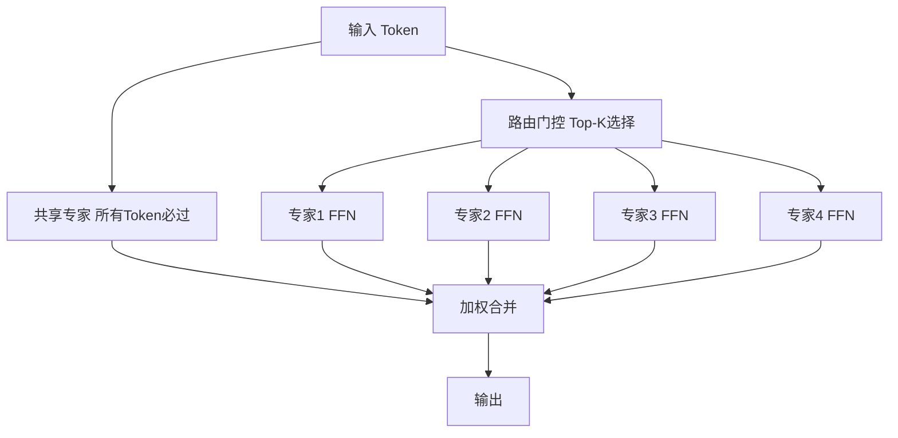

## 概念：一家医院的"专家门诊"模式

混合专家（Mixture of Experts，MoE）是一种让 LLM 既庞大又高效的架构技巧。它的核心思想可以用一句话概括：**不是所有参数都参与每次计算。**

生活比喻：想象一家大型综合医院。医院里有心内科、骨科、皮肤科、神经内科等几十个科室（专家）。每个病人来到医院，分诊台的护士（路由门控，Router/Gate）根据症状决定该去哪个科室——不需要所有科室的所有医生同时来看这个病人。MoE 做的事完全一样：输入一个 token，路由器判断"这个 token 应该找哪几个专家处理"，只有被选中的 2-4 个专家才真正参与计算 ^[Shazeer et al., "Outrageously Large Neural Networks: The Sparsely-Gated Mixture-of-Experts Layer", ICLR 2017, https://arxiv.org/abs/1701.06538]。

在 Transformer 架构中，MoE 层替换了标准的前馈网络（FFN）——也就是 Transformer 中负责"思考"每一层输出的那个部分。替换后的计算变成了加权投票：路由器给每个选中的专家打分，最终输出是所有选中专家输出的加权和 ^[NVIDIA, "What Is Mixture of Experts (MoE) and How It Works?", 2026, https://www.nvidia.com/en-us/glossary/mixture-of-experts/]。

**关键参数与公式：**

标准 Transformer FFN：`output = W2 * ReLU(W1 * x)`

MoE 层：`output = sum(g_i(x) * Expert_i(x))`，其中 `g_i(x)` 是路由器为第 i 个专家分配的权重，只有 Top-K 个专家的 `g_i(x)` 非零，其余专家的计算直接跳过 ^[Fedus et al., "Switch Transformers: Scaling to Trillion Parameter Models", JMLR 2022, https://arxiv.org/abs/2101.03961]。

这带来了一个看似矛盾的结果：总参数量可以极大（DeepSeek-V3 有 671B 参数），但每次推理只激活一小部分（37B）。这就是"稀疏激活"的含义——模型像一个沉睡的巨人，每次只唤醒它的一小部分。

## 教学：2026 年 MoE 的核心设计要素

### 路由门控：谁来分诊？

路由器的数学表达很简单：

```
Router(x) = Softmax(TopK(x * W_gate))
```

其中 `W_gate` 是可学习的路由参数矩阵，TopK 只保留最大的 K 个值，其余置为 0。通常 K=2（每个 token 发给 2 个专家），少数模型用 K=1 或 K=8 ^[Jiang et al., "Mixtral of Experts", 2024, https://arxiv.org/abs/2401.04088]。

路由器的"智能"在于：经过训练，不同专家会自然分化出不同的"专长"——有的擅长代码语法，有的擅长数学推理，有的擅长文学表达。这种专业化不需要人工干预，是在训练过程中自发形成的。

### 负载均衡：如何防止"全员涌向心内科"？

如果所有 token 都选择同一个专家，MoE 退化为普通稠密模型——那个专家过载，其他专家闲置。这个问题在训练早期尤其危险：路由器可能会"锁定"在少数几个专家上，导致训练坍塌。

2026 年的三种主流解决方案 ^[DeepSeek-AI, "DeepSeek-V3 Technical Report", 2024, https://arxiv.org/abs/2412.19437]：

| 策略 | 方法 | 优缺点 |
|------|------|--------|
| 辅助损失（Auxiliary Loss） | 在总损失中加一项，惩罚专家负载不均衡 | 有效但调参敏感，过强的辅助损失会干扰主任务 |
| 专家容量（Expert Capacity） | 限制每个专家最多处理多少 token，超出的 token 直接跳过该层 | 简单粗暴，但丢弃 token 可能损失信息 |
| 无辅助损失负载均衡（DeepSeek 创新） | 动态调整路由器偏置项，不添加额外损失函数，而是通过偏置项引导路由趋于均衡 | 2026 年最优雅的方案，不牺牲主任务性能 |

### DeepSeek 的 MoE 创新

DeepSeek 在 MoE 方面有两个关键贡献，使其成为 2026 年开源阵营的 MoE 标杆 ^[DeepSeek-AI, "DeepSeek-V2: A Strong, Economical, and Efficient Mixture-of-Experts Language Model", 2024, https://arxiv.org/abs/2405.04434]：

1. **细粒度专家分割（Fine-grained Expert Segmentation）：** 传统 MoE 每个专家和标准 FFN 一样大。DeepSeek 把每个专家切成更小的粒度——专家数量更多但每个专家更小，路由更灵活。打个比方：不是把医院分成"内科"和"外科"两个大科室，而是分成几十个亚专科，分诊更精准。

2. **共享专家（Shared Experts）：** 除了路由选择的专家外，还有一组"共享专家"——所有 token 都经过共享专家处理。共享专家负责通用知识（如语法、常识），路由专家负责专业化知识（如代码、数学）。这种设计像医院的"急诊科"：不管什么症状，先做基础检查，再转专科。



### 2026 年关键 MoE 模型速查

| 模型 | 总参数 | 激活参数 | 激活比 | 核心优势 |
|------|--------|----------|--------|----------|
| DeepSeek-V4 | 1.2T | 60B | 5% | 开源阵营推理之王，成本极低 |
| Mixtral 8x22B | 141B | 39B | 28% | 吞吐优化，推理速度快 |
| Qwen 3.7 MoE | 57B | 14.3B | 25% | 全尺寸开源，边缘设备友好 |
| Llama 4 Maverick | 400B | 17B | 4% | 通用推理强，多语言能力好 |

## 注意事项：MoE 不是免费的午餐

1. **显存占用巨大。** 虽然每次推理只激活少数专家，但所有专家的参数都必须常驻显存。DeepSeek-V4 的 1.2T 参数不可能全放在一张 GPU 上，必须跨多卡分布式部署。推理速度虽快于同等参数的稠密模型，但硬件门槛更高 ^[HuggingFace, "MoEs in Transformers", 2026, https://huggingface.co/blog/moe-transformers]。

2. **训练不稳定。** MoE 的训练收敛比稠密模型更敏感，尤其是在负载均衡策略和路由器初始化方面。如果路由器在训练早期就固化在少数专家上，后续训练几乎无法纠正。

3. **微调困难。** MoE 在下游任务微调时比稠密模型更容易过拟合。每个专家的参数量其实不大（因为是细粒度切分的），在小数据集上微调容易导致专家丧失专业化分工。

4. **专家坍缩（Expert Collapse）。** 当模型遇到训练分布之外的数据时，路由器可能无法做出合理的分诊决策，导致所有 token 涌向同几个专家——这就是"专家坍缩"。2026 年的解决方向包括专家再训练（periodic expert re-balancing）和路由扰动（routing perturbation）。

5. **2026 年趋势：混合稠密+MoE。** 部分层使用稠密计算（如注意力层），部分层使用 MoE（如 FFN 层），综合两者的优势。Qwen 3.7 和 Nemotron 3 都采用了这种混合策略 ^[Softtechas, "Advancements in Modern LLM Architectures", 2026, https://medium.com/softtechas/advancements-in-modern-llm-architectures-b204fe8f0ee8]。

## 关联

- [[概念-MoE]] — 子文件夹中的深度概念文档，含负载均衡公式和完整模型列表
- [[概念-DeepSeek]] — DeepSeek 家族的 MLA + MoE 架构详解
- [[概念-Jamba]] — Jamba 混合架构（MoE + SSM）探索
- [[10.5 Scaling Law-更大的力量]] — MoE 如何改变 Scaling Law 的计算
- [[Ch09 Transformer 架构精讲]] — MoE 替换的 FFN 层在 Transformer 中的位置
- [[10.3 2026 年开源 LLM 版图]] — 各开源模型的 MoE 选型对比

---

> 上一节：[[10.3 2026 年开源 LLM 版图]]  |  下一节：[[10.5 Scaling Law-更大的力量]]  |
