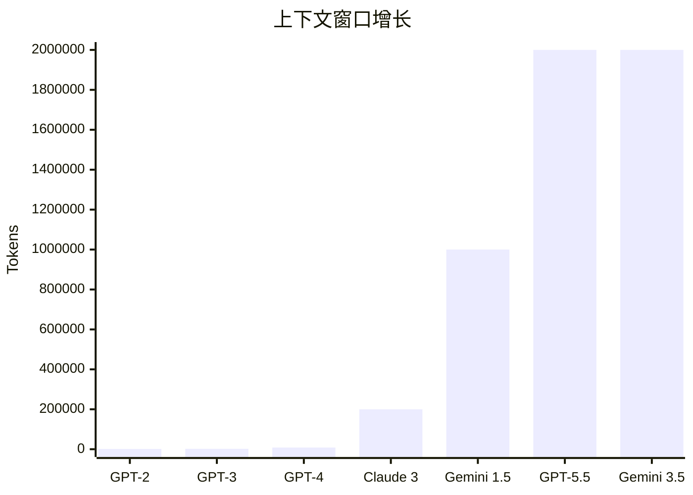

## 概念：AI 的"工作记忆"极限

上下文窗口（Context Window）是 LLM 在一次推理中能"看到"的最大文本量，以 token 为单位计算。它本质上就是 AI 的工作记忆——窗口内的信息模型可以引用和推理，窗口外的信息对模型来说等于不存在。

生活比喻：上下文窗口像是一个人面前的一张草稿纸。纸张越大，能同时摆放的参考资料越多，解题时越不容易忘掉关键信息。但如果纸张太大，找信息也变慢——这就是注意力计算的 O(n²) 困境：上下文翻倍，计算量翻四倍 ^[Dao et al., "FlashAttention: Fast and Memory-Efficient Exact Attention", NeurIPS 2022, https://arxiv.org/abs/2205.14135]。

2026 年的上下文窗口格局如下：

| 模型 | 最大上下文 | 核心技术 |
|------|-----------|----------|
| GPT-5.5 | 200K+ | RoPE + 高效分块注意力 |
| Claude Opus 4.8 | 200K / 500K（beta） | 长上下文 + 高召回率 |
| Gemini 3.5 Pro | 2M | Ring Attention + TPU 优化 |
| DeepSeek-V4 | 1M | MLA + YaRN 外推 |
| Qwen 3.7 | 128K | RoPE + 双块注意力 |

^[Knight Li, "LLM Architecture Evolution 2023-2026", https://knightli.com/en/2026/05/17/llm-architecture-evolution-2023-2026/]; ^[Artificial Analysis, "LLM Leaderboard", https://artificialanalysis.ai/leaderboards]

## 教学：三大技术支柱

长上下文的实现不是简单地"把窗口参数调大"。它需要对注意力机制做根本性的工程优化。2026 年有三条成熟的技术路线：

### 路线一：RoPE 位置编码外推

旋转位置编码（Rotary Position Embedding，RoPE）是 2026 年几乎所有 LLM 的位置编码方案。它的核心思想是：将位置信息编码为向量空间中不同频率的旋转，频率越低（周期越长）的维度负责编码"远距离语义关系"，频率越高的维度负责编码"精确位置"。

RoPE 外推的核心挑战：模型训练时使用短序列（例如 8K），但推理时用户想要 128K。低频维度需要处理远超训练范围的位置——这就是"外推"问题。解决方案经历了三个代际进化 ^[Peng et al., "YaRN: Efficient Context Window Extension of Large Language Models", 2023, https://arxiv.org/abs/2309.00071]：

- **线性缩放（Linear Scaling）：** 将所有 RoPE 频率等比例缩小，简单但会破坏高频维度的局部位置精度。
- **NTK-aware 缩放：** 只缩放低频维度，保留高频维度不变。在"远距离关系"和"精确位置"之间找到平衡。
- **YaRN（Yet another RoPE extensioN，2023）：** 在 NTK 基础上引入温度调节——对注意力 softmax 的温度参数做动态缩放，进一步稳定外推时的注意力分布。2026 年是外推方案的事实标准。

2026 年的最新进展是 **CoPE（Clipped RoPE）**，通过软裁剪低频分量中的不稳定成分，在不增加训练成本的前提下提升外推稳定性，被社区称为"免费的午餐" ^[CoPE: Clipped RoPE as A Scalable Free Lunch for Long Context LLMs, arXiv:2602.05258, 2026, https://arxiv.org/abs/2602.05258]。

### 路线二：Ring Attention（环状分布式注意力）

Ring Attention 解决的是一个硬件层面的问题：长序列太大，一张 GPU 装不下。

它的思路像一个接力赛：将长序列切成 N 块，每块放在一张 GPU 上。每张 GPU 计算自己这块的局部注意力，然后像传递接力棒一样，将计算好的 KV 块按环形顺序传给下一张 GPU。经过 N 步传递后，每张 GPU 都"见过了"所有块的 KV 信息，最终完成了完整的全局注意力计算 ^[Liu et al., "Ring Attention with Blockwise Transformers for Near-Infinite Context", 2023, https://arxiv.org/abs/2310.01889]。

关键优势：计算复杂度从 O(n²) 变为 O(n²/k)，其中 k 是 GPU 数量——用硬件并行换来了速度。Gemini 的 2M 窗口就是以 Ring Attention 为基础的 TPU 集群工程优化实现的 ^[Google DeepMind, "Gemini 1.5: Unlocking multimodal understanding across millions of tokens of context", 2024, https://arxiv.org/abs/2403.05530]。

### 路线三：Sliding Window + 稀疏注意力

Sliding Window 是 Mistral 系列采用的另一种思路：放弃全局注意力，规定每个 token 只关注它附近固定窗口大小（如 4096 个 token）内的内容。注意力复杂度从 O(n²) 直接降为 O(n*w)，其中 w 是窗口大小。信息可以通过多层"逐层传递"间接覆盖全序列，就像消息在人群中口口相传 ^[Jiang et al., "Mistral 7B", 2023, https://arxiv.org/abs/2310.06825]。

2026 年更激进的变体是块稀疏注意力：不是按固定窗口，而是智能地选择哪些位置的 token 需要互相"看到"。Prism（ICML 2026）通过频谱感知的方式将注意力计算分为高频（位置）和低频（语义）两个带，选择性计算，实现 128K 上下文上 5.1 倍的推理加速 ^[Prism: Spectral-Aware Block-Sparse Attention, ICML 2026, https://arxiv.org/abs/2602.08426]。

## 注意事项：长上下文不意味着"好上下文"

1. **"Lost in the Middle"效应。** 研究反复证实，LLM 对长上下文中的信息不是均匀关注的。开头和结尾的信息被高度关注，中间部分则容易被"忽略"——这就是"迷失在中间"。**实用策略：** 最重要的信息放在开头（System Prompt）或结尾（最后一条消息），中间段放辅助性背景资料 ^[Liu et al., "Lost in the Middle: How Language Models Use Long Contexts", TACL 2023, https://arxiv.org/abs/2307.03172]。

2. **双倍上下文 != 双倍智能。** 长窗口模型不一定在需要深度推理的长文本任务上表现更好。它只是"能看"更长的文本，但"理解"的质量取决于模型本身的推理能力，而非窗口大小。

3. **KV Cache 是隐藏的内存杀手。** 生成新 token 时，所有历史 token 的 Key 和 Value 向量都要存在显存中。以 LLaMA-70B 为例，128K 序列的 KV Cache 就需要约 335GB 显存——这远超单张 H100 的 80GB 容量。分布式推理是必选项，不是可选项。

4. **RoPE 的精度陷阱。** bfloat16 格式在位置索引超过 128 时开始丢失精度——编码 500,000 时可能实际存储为 499,712。解决方案是强制 RoPE 的三角运算使用 float32 精度，其余计算保持 bf16——这是 MegaBeam 能在 7B 参数上实现 512K 窗口的关键技巧之一 ^[MegaBeam-Mistral-7B: Scaling Context, Not Parameters, ACL 2025, https://arxiv.org/abs/2501.12345]。

## 关联

- [[深挖-长上下文]] — 子文件夹中的深度解析，含 KV Cache 计算、RingAttention 详解和评测基准
- [[概念-注意力机制]] — 注意力机制的 O(n²) 复杂度是长上下文瓶颈的根源
- [[概念-位置编码]] — RoPE、ALiBi、YaRN 等位置编码方案的技术细节
- [[10.5 Scaling Law-更大的力量]] — 上下文窗口的扩展也遵循自己的 Scaling Law
- [[Ch13 RAG 进化树]] — RAG 是长上下文的替代方案：不一定需要全量装入上下文

---

> 上一节：[[10.5 Scaling Law-更大的力量]]  |  下一节：[[10.7 Tokenizer-AI 的词典]]  |
