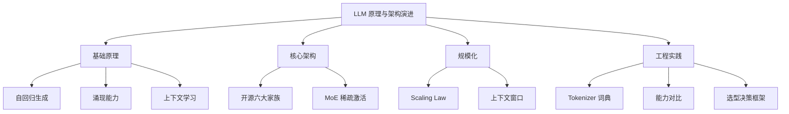

> 本章承接第 9 章 Transformer，聚焦 LLM 层面的架构演进：从自回归生成的基本原理到 2026 年的 [[概念-MoE|MoE]] 稀疏激活、Scaling Law 的理论与修正、上下文窗口的军备竞赛，以及开源 LLM 的六大家族格局。

## 本章目录

1. [[10.1 什么是 LLM|10.1 什么是 LLM]] — 自回归生成、涌现能力、上下文学习；含 GPT 系列演进
2. [[10.3 2026 年开源 LLM 版图|10.3 2026 年开源 LLM 版图]] — 六大家族、三个梯队、架构演进时间线
3. [[10.4 MoE-稀疏激活的艺术|10.4 MoE：稀疏激活的艺术]] — 医院专家门诊比喻、路由门控、负载均衡、DeepSeek 创新
4. [[10.5 Scaling Law-更大的力量|10.5 Scaling Law：更大的力量]] — 幂律公式、Chinchilla 最优、2026 年修正
5. [[10.6 上下文窗口的军备竞赛|10.6 上下文窗口的军备竞赛]] — RoPE 外推、Ring Attention、Sliding Window
6. [[10.7 Tokenizer-AI 的词典|10.7 Tokenizer：AI 的词典]] — BPE/WordPiece/SentencePiece 三大算法对比
7. [[10.8 2026年主流LLM能力对比|10.8 2026年主流LLM能力对比]] — 六大模型能力、价格、隐私全方位对比
8. [[10.9 LLM选型决策框架|10.9 LLM选型决策框架]] — 任务-预算-隐私三维决策框架

## 子文件夹

- [[Ch04 机器学习核心算法]] — Token、MoE、DeepSeek、Gemini、推理模型、RLAIF、RWKV、Jamba 等概念深度文档
- [[Ch04 机器学习核心算法]] — Mamba 架构、长上下文技术等深度解析
- [[Ch10 LLM 原理与架构演进]] — 从零训练分词器实践项目

## 跨章节关联

- [[Ch13 RAG 进化树]] — LLM 的三大局限催生了 RAG
- [[Ch11 模型微调]] — 预训练后的下一步：微调让 LLM 学会对话
- [[Ch09 Transformer 架构精讲]] — LLM 的底层架构：Decoder-Only Transformer
- [[Ch20 模型推理部署]] — 训练完的 LLM 怎么跑起来

## 来源

1. Radford et al., "Improving Language Understanding by Generative Pre-Training", OpenAI, 2018
2. Brown et al., "Language Models are Few-Shot Learners", NeurIPS 2020
3. Schaeffer et al., "Are Emergent Abilities of Large Language Models a Mirage?", NeurIPS 2023
4. Dherin et al., "Learning without training: The implicit dynamics of in-context learning", Google, 2026
5. Ma et al., "Beyond the Prompt in Large Language Models", 2026
6. Kaplan et al., "Scaling Laws for Neural Language Models", OpenAI, 2020
7. Hoffmann et al., "Training Compute-Optimal Large Language Models" (Chinchilla), NeurIPS 2022
8. Bryant, "Practical Scaling Laws for Data-Constrained Worlds", 2026
9. Bian et al., "Scaling Laws Meet Model Architecture", ICLR 2026
10. Li et al., "Optimal Expert-Attention Allocation in Mixture-of-Experts", 2026
11. Shazeer et al., "Outrageously Large Neural Networks: The Sparsely-Gated MoE Layer", ICLR 2017
12. Fedus et al., "Switch Transformers", JMLR 2022
13. Jiang et al., "Mixtral of Experts", 2024
14. DeepSeek-AI, "DeepSeek-V2 Technical Report", 2024
15. DeepSeek-AI, "DeepSeek-V3 Technical Report", 2024
16. Dao et al., "FlashAttention", NeurIPS 2022
17. Liu et al., "Ring Attention with Blockwise Transformers", 2023
18. Peng et al., "YaRN: Efficient Context Window Extension", 2023
19. Liu et al., "Lost in the Middle", TACL 2023
20. Sennrich et al., "Neural Machine Translation of Rare Words with Subword Units" (BPE), ACL 2016
21. Kudo and Richardson, "SentencePiece", EMNLP 2018
22. Kudo, "Subword Regularization" (Unigram), ACL 2018
23. NVIDIA, "What Is Mixture of Experts (MoE) and How It Works?", 2026
24. HuggingFace, "MoEs in Transformers", 2026
25. FutureAGI, "What is Tokenization in LLMs?", 2026
26. Artificial Analysis, "LLM Leaderboard", https://artificialanalysis.ai/leaderboards
27. Chatbot Arena, "LMSYS Leaderboard", https://lmarena.ai/
28. Coursera, "AI Learning Roadmap 2026"
29. Towards Data Science, "Realistic AI Career Roadmap 2026"
30. Sebastian Raschka, "LLM Research Papers 2026"
31. Knight Li, "LLM Architecture Evolution 2023-2026"
32. Developers Digest, "LLM Architecture Complexity"
33. Softtechas, "Advancements in Modern LLM Architectures", 2026
