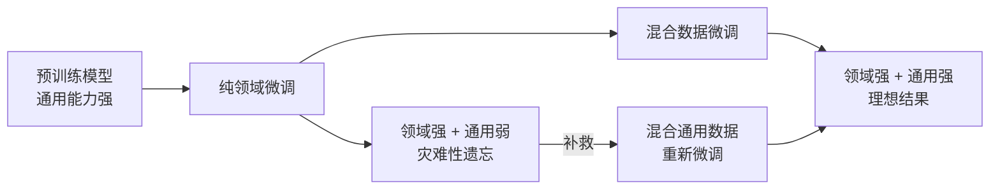

微调有一个常见的副作用：**灾难性遗忘（Catastrophic Forgetting）**。这是微调中最容易被忽视、但影响最大的问题之一。

### 11.7.1 什么是灾难性遗忘

当你用某个领域的数据（比如医学文献）微调模型时，模型会逐渐"忘记"它在预训练阶段学到的其他知识。就像一个学生突击复习数学，结果把之前学过的历史忘得差不多了。

具体表现：
- 微调后，模型在你训练的任务上表现很好，但在其他任务上明显退步
- 模型可能连基本的常识问答都开始出错
- 对话能力下降，回复变得"机器人化"

### 11.7.2 为什么微调会让模型"忘记"之前的知识

预训练阶段，模型从海量多样化文本中学习了一个通用的"世界知识分布"。当你用单一领域的数据反复训练时，模型参数会朝着这个领域的"局部最优"方向偏移，逐渐偏离原来的通用知识分布。数学上，这是一个**分布偏移（Distribution Shift）**问题——模型优化了新任务上的损失函数，但代价是破坏了原有的泛化能力。

### 11.7.3 缓解策略

| 策略 | 做法 | 效果 |
|------|------|------|
| 混合数据 | 训练数据中混入 10-20% 的通用数据 | 最有效，让模型"温故知新" |
| 小学习率 | 使用比预训练小 10-100 倍的学习率 | 限制参数更新幅度，防止大幅偏离 |
| 正则化 | L2 正则化或 EWC（弹性权重巩固） | 保护重要参数不被大幅修改 |
| 早停（Early Stopping） | 在验证集上监控通用能力，一退化就停 | 简单但需要设计好监控指标 |
| 逐层解冻 | 先只训练最后几层，逐步解冻更多层 | 控制参数变化范围 |

### 11.7.4 实际案例

2024 年，某团队用纯医学文献微调某开源模型，结果模型在医学考试上分数提高了 15%，但在日常对话中开始出现幻觉——问"今天星期几"会回答"根据临床指南，医生应每周随访患者"。经过混合 15% 通用数据后，医学能力保留，通用能力恢复到微调前水平。

---

> 上一节：[[11.5 DPO与偏好对齐]]  |  下一节：[[11.7 2026年微调新趋势]]
