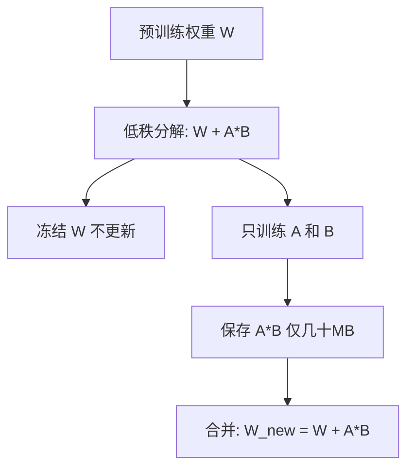

> 这篇是进阶内容，面向想理解 LoRA 原理的读者。如果你是零基础初学者，先读 [[Ch11 模型微调|第11章]] 了解基本概念再回来看这篇。

> **公式可跳过**：文中出现的矩阵符号（W ≈ A × B）可以直接跳过，看文字解释即可理解 LoRA 的核心思想。

[[Ch11 模型微调]] 介绍了 LoRA 的概念——在原有模型旁加一个小模块，只训练这个模块。这篇深入：为什么这个小模块能工作？怎么调它的参数？

## 矩阵分解的直觉



假设你有一个 1000×1000 的矩阵。存储它需要 100 万个数字。但如果这个矩阵有大量冗余——很多行和行之间高度相似——它可能可以分解成两个小矩阵的乘积：

```
W (1000×1000) ≈ A (1000×8) × B (8×1000)
```

原本 100 万个参数，现在只需要 1000×8 + 8×1000 = 16000 个参数。压缩了 60 倍。

这就是 LoRA 的核心思想：**模型权重的变化（Delta W）是低秩的——可以用两个小矩阵来近似。** 不需要修改原来的大矩阵 W，只需要训练两个小矩阵 A 和 B ^[Hu et al., "LoRA", 2021, https://arxiv.org/abs/2106.09685]。

## LoRA 插在哪里

不是所有的模型层都适合插 LoRA。原论文的发现：

**最应该插的地方：注意力层的 Q 和 V 投影矩阵。**

Q（Query）：控制"查询什么"
V（Value）：控制"输出什么"

这两层对微调任务最敏感。K（Key）和 FFN（前馈网络）的 LoRA 收益较小。

实践中，多数人同时给 Q 和 V 插 LoRA。如果效果不够，再加上 FFN ^[Dettmers et al., "QLoRA", 2023, https://arxiv.org/abs/2305.14314]。

## 关键超参数：r 和 alpha

**r（秩，Rank）**：两个小矩阵的中间维度。r 越大，LoRA 模块的容量越大，能学的东西越多——但参数也越多，训练越慢。

| r 值 | 参数增量 | 适用 |
|------|---------|------|
| 4 | 极少 | 简单任务（指令格式调整） |
| 8 | 少 | 一般任务（默认推荐） |
| 16 | 中 | 复杂任务（需要学大量新知识） |
| 64 | 多 | 极少使用（接近全量微调了） |

**最佳实践**：从 r=8 开始。如果 loss 降不下去，尝试 r=16。不需要调到 64 以上——收益递减。

**alpha**：LoRA 输出的缩放因子。简单理解：alpha 越大，LoRA 对最终输出的影响越大。

通常设置 `alpha = 2×r` 或 `alpha = r`。alpha/r 的比例决定 LoRA 的"激进程度"——比例越高，LoRA 越强势。

## LoRA 训练配置

```python
from peft import LoraConfig, get_peft_model

config = LoraConfig(
    r=8,              # 秩
    lora_alpha=16,    # 缩放因子（alpha = 2×r）
    target_modules=["q_proj", "v_proj"],  # 插在哪
    lora_dropout=0.1, # 防止过拟合
)

model = get_peft_model(base_model, config)
model.print_trainable_parameters()
# trainable params: 4,194,304 || all params: 7,004,194,304 || trainable%: 0.06%
```

注意：**只有 0.06% 的参数需要训练。** 这就是为什么 LoRA 能在单卡上微调 70B 模型。

## LoRA 的变体

**QLoRA**（2023）：主体模型 4-bit 量化 + LoRA。单张 24GB 显卡微调 70B 模型 ^[Dettmers et al., "QLoRA", 2023]。

**DoRA**（2024）：把权重矩阵分解为"方向"和"幅度"，只微调方向。效果优于 LoRA，参数量差不多 ^[Liu et al., "DoRA: Weight-Decomposed Low-Rank Adaptation", 2024, https://arxiv.org/abs/2402.09353]。

**LoRA+**（2024）：给 A 和 B 矩阵设置不同的学习率。B 矩阵需要更大的学习率——因为它的维度更大，梯度更稀疏。

## LoRA 的局限

1. **不能学全新的知识。** LoRA 是"微调"，不是"重训"。如果任务需要知识量和原模型训练数据差不多，LoRA 不够——需要全量微调
2. **多个 LoRA 不能简单叠加。** 你有一个"写法律文书"的 LoRA 和"用文言文"的 LoRA。不能直接两个都加载——它们会互相干扰。需要用 MergeKit 先合并
3. **r 不能无脑加大。** r=256 的 LoRA 参数量和全量微调差不多了，失去了 LoRA 的意义

## 相关笔记

- [[Ch11 模型微调]] — LoRA 是 PEFT 的一种
- [[深挖-QLoRA]] — 量化+LoRA
- [[深挖-模型合并]] — 多 LoRA 合并技术

## 来源

- Hu et al., "LoRA", 2021, https://arxiv.org/abs/2106.09685
- Dettmers et al., "QLoRA", 2023, https://arxiv.org/abs/2305.14314
- Liu et al., "DoRA", 2024, https://arxiv.org/abs/2402.09353
