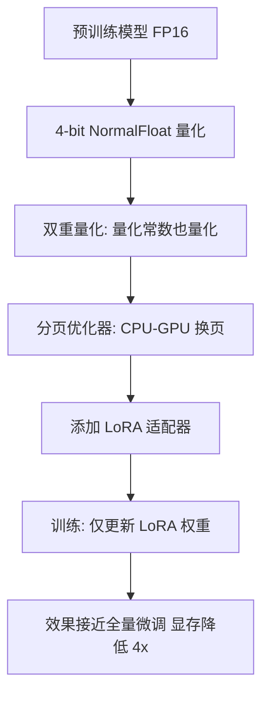

## 一句话理解

QLoRA = **4-bit 量化的基座模型** + **LoRA 适配器**。通过将预训练模型权重量化到 4-bit（NF4 格式），让原本需要 48GB 显存的 7B 模型微调，可以在单张 12GB 消费级显卡上完成，同时效果仅比全精度 LoRA 低 1%-3%。

## 为什么需要 QLoRA



在没有 QLoRA 之前，微调大模型面临残酷的显存困境：

| 模型大小 | 全量微调显存 | LoRA 显存 | 消费级 GPU 能否跑 |
|---------|------------|----------|-----------------|
| LLaMA-7B | ~56 GB | ~18 GB | 勉强（RTX 4090 24GB） |
| LLaMA-13B | ~104 GB | ~30 GB | 不行 |
| LLaMA-33B | ~260 GB | ~70 GB | 不行 |
| LLaMA-65B | ~520 GB | ~140 GB | 不行 |

QLoRA 改变了这一切：

| 模型大小 | QLoRA (4-bit) 显存 | 消费级 GPU |
|---------|-------------------|-----------|
| LLaMA-7B | ~6 GB | RTX 3060 (12GB) |
| LLaMA-13B | ~10 GB | RTX 4070 (12GB) |
| LLaMA-33B | ~20 GB | RTX 4090 (24GB) |
| LLaMA-65B | ~38 GB | RTX 4090 (24GB) + offloading |
| LLaMA-70B | ~42 GB | 2x RTX 4090 (48GB) |

## 核心创新

QLoRA 论文提出了三项关键技术，共同实现了 4-bit 微调的可能性：

### 1. NF4 数据类型（4-bit NormalFloat）

传统的 INT4 量化将 FP32 权重均匀映射到 16 个整数值（-8 到 7）。但神经网络的权重并非均匀分布——它们近似正态分布（大部分权重集中在 0 附近）。

NF4 的设计思路：**假设权重服从正态分布，将 4-bit 的 16 个取值点按正态分布的分位数放置，使信息损失最小化。**

| 量化格式 | 设计思路 | 适用数据 | 精度损失 |
|---------|---------|---------|---------|
| INT4 | 均匀量化 | 均匀分布 | 对正态分布数据损失大 |
| FP4 | 浮点量化 | 范围大 | 表达精度不足 |
| **NF4** | 正态分布分位数 | 神经网络权重 | 最优 |

> 简单说：NF4 好比在权重集中的区域（0 附近）放更多"刻度"，在权重稀疏的区域（两端）放更少"刻度"，从而在 4-bit 的约束下最大化信息保留。

### 2. 双重量化（Double Quantization）

量化不仅需要存储量化后的权重值，还需要存储**量化常数**（scaling factor 和 zero point）。对于 64 个参数一组（block size = 64），量化常数也是 FP32 的，这本身就会占用可观的显存。

双重量化：**对量化常数再做一次量化**（从 FP32 量化到 FP8），进一步压缩显存。

| 量化策略 | 每个参数的平均位数 | 7B 模型显存 |
|---------|-----------------|------------|
| 单次量化 (4-bit + FP32 常数) | ~4.5 bits | ~5.5 GB |
| 双重量化 (4-bit + FP8 常数) | ~4.13 bits | ~4.8 GB |

节省约 0.7 GB，对于 24GB 显卡来说，这点空间可以容纳更大的 batch size 或更长的序列。

### 3. 分页优化器（Paged Optimizers）

训练时可能出现显存尖峰（out-of-memory spike），即使平均显存占用不高。分页优化器借鉴操作系统的**内存分页**思想：当 GPU 显存不足时，自动将优化器状态换出到 CPU 统一内存，尖峰过后再换回来。

> 这就像你的电脑内存不够时，系统会把一部分数据暂时写入硬盘的虚拟内存——分页优化器在 GPU 和 CPU 之间做同样的事。

## QLoRA vs LoRA 对比

| 维度 | LoRA（FP16/BF16） | QLoRA（NF4 4-bit） |
|------|------------------|-------------------|
| 基座模型精度 | FP16 或 BF16（16-bit） | NF4（4-bit） |
| 显存占用（7B 模型） | ~18 GB | ~6 GB |
| 训练速度 | 快（无量化反量化开销） | 比 LoRA 慢 20%-40% |
| 最终效果 | 基准 | 比 LoRA 低 1%-3% |
| 适用 GPU | A100 / A6000 / RTX 4090 | RTX 3060+ / 消费级卡 |
| 推理合并 | 直接合并，FP16 推理 | 合并后转回 FP16，无额外开销 |
| 框架支持 | 所有框架 | HuggingFace PEFT, Unsloth, Axolotl |

### 效果差异详解

| 任务类型 | LoRA (FP16) | QLoRA (NF4) | 差距 |
|---------|------------|------------|------|
| 指令遵循 | 优秀 | 优秀 | 几乎无差距 |
| 知识问答 | 优秀 | 良好 | 1%-2% |
| 代码生成 | 优秀 | 良好 | 1%-3% |
| 数学推理 | 良好 | 良好 | 1%-2% |
| 创意写作 | 优秀 | 优秀 | 几乎无差距 |
| 多语言翻译 | 优秀 | 良好 | 1%-3% |

**结论**：对于大多数指令微调场景，QLoRA 的效果与 LoRA 几乎无差别。在需要精确数值计算的任务（数学推理、代码生成）上，QLoRA 有 1%-3% 的微小损失。

## 2026 年定位

QLoRA 是 **消费级 GPU 微调大模型的事实标准**。2026 年的关键进展：

1. **Unsloth 框架**：通过手写 CUDA 内核和 Triton 优化，将 QLoRA 训练速度提升 2-5 倍，显存再降 40%-60%。在 RTX 4090 上微调 LLaMA-3-8B，从原来的 8 小时缩短到 2 小时。

2. **HQQ（Half-Quadratic Quantization）**：无需校准数据的 4-bit 量化方法，进一步简化了 QLoRA 流程。

3. **BitNet 等 1-bit 模型**：原生 1.58-bit 模型架构的出现，使得量化不再是"妥协"，而是"原生设计"。这些模型微调时几乎不需要额外量化处理。

4. **QLoRA + 更长上下文**：结合 Ring Attention、YaRN 等技术，在消费级 GPU 上微调 128K 上下文窗口的模型已成为可能。

## QLoRA 配置示例

```python
from transformers import BitsAndBytesConfig
from peft import LoraConfig, get_peft_model

# 4-bit 量化配置
bnb_config = BitsAndBytesConfig(
    load_in_4bit=True,                    # 加载为 4-bit
    bnb_4bit_quant_type="nf4",           # 使用 NF4 数据类型
    bnb_4bit_compute_dtype=torch.bfloat16, # 计算时用 BF16
    bnb_4bit_use_double_quant=True,       # 双重量化
)

# 加载量化模型
model = AutoModelForCausalLM.from_pretrained(
    "meta-llama/Llama-3-8B",
    quantization_config=bnb_config,
    device_map="auto",
)

# LoRA 配置（与普通 LoRA 完全相同）
lora_config = LoraConfig(
    r=16,
    lora_alpha=32,
    lora_dropout=0.05,
    target_modules=["q_proj", "k_proj", "v_proj", "o_proj"],
)

model = get_peft_model(model, lora_config)
```

## QLoRA 的局限性

1. **训练速度比 LoRA 慢**：每次前向/反向传播都需要将 4-bit 权重反量化到 BF16，增加了计算开销（约 20%-40%）。

2. **4-bit 量化对某些任务有微小影响**：特别是需要精确数值计算的任务（如数学推理），4-bit 精度损失会导致 1%-3% 的效果下降。

3. **量化过程的校准依赖**：虽然 NF4 不需要校准数据，但其他 4-bit 量化方法（如 GPTQ、AWQ）需要校准数据集，选择不当会影响效果。

4. **不支持所有模型架构**：某些非标准 Transformer 架构可能不支持 4-bit 量化加载。

5. **多卡训练复杂**：QLoRA 在多卡分布式训练（FSDP/DeepSpeed）中的支持不如全精度 LoRA 成熟。

## 相关笔记

- [[深挖-LoRA]] — 低秩适配，QLoRA 的基础
- [[深挖-量化]] — 模型量化技术深入
- [[Ch11 模型微调]] — 微调基础知识
- [[深挖-PEFT]] — PEFT 方法总览
- [[深挖-DoRA]] — LoRA 改进版，也可与 QLoRA 结合
- [[深挖-LoRA微调]] — LoRA 微调实操
- [[用 LoRA 微调模型]] — 项目实战

## 来源

- Dettmers et al., "QLoRA: Efficient Finetuning of Quantized LLMs", 2023, https://arxiv.org/abs/2305.14314
- Dettmers et al., "8-bit Optimizers via Block-wise Quantization", 2022, https://arxiv.org/abs/2110.02861
- Badri & Shaji, "HQQ: Half-Quadratic Quantization of Large Machine Learning Models", 2023, https://arxiv.org/abs/2306.13578
- Unsloth AI, https://github.com/unslothai/unsloth
- HuggingFace QLoRA Tutorial, https://huggingface.co/blog/4bit-transformers-bitsandbytes
- HuggingFace PEFT Documentation, https://huggingface.co/docs/peft