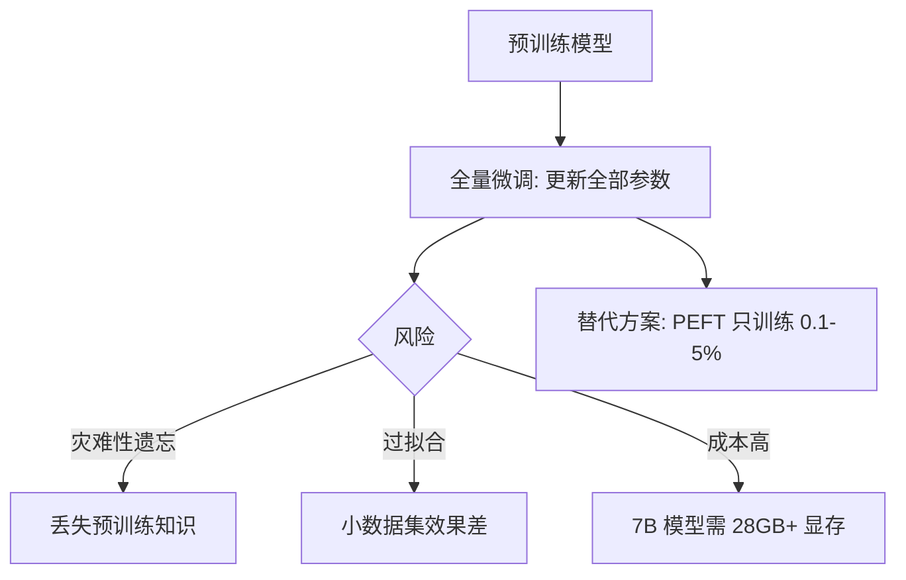

## 一句话理解

在预训练模型（Pre-trained Model）的基础上，用特定任务的数据集，**更新模型的所有参数**（全部权重），使模型从"通用能力"转向"特定领域能力"。这是最传统、最彻底的微调方式。

## 零基础理解

预训练模型像一个"读完整个图书馆的人"——他什么都知道一点，但什么都不精通。全量微调就是让他去"医学院深造"——他读过的所有书（所有参数）都被重新校准，以适配医学这个新领域。代价是：他不再是原来那个"通才"了——这叫**灾难性遗忘**（Catastrophic Forgetting）。

> 类比：一本百科全书，全量微调 = 把整本书重新排版印刷，只为突出某个章节。PEFT = 在那个章节旁边贴几张便利贴。

## 核心概念

### 1. 学习率选择

全量微调的学习率必须比预训练阶段小得多，通常小 10-100 倍。

| 阶段 | 典型学习率 | 原因 |
|------|-----------|------|
| 预训练（Pre-training） | 1e-4 ~ 3e-4 | 从头学习，需要大步长 |
| 全量微调（Full FT） | 1e-5 ~ 5e-5 | 已有良好初始化，只需小幅调整 |
| PEFT（LoRA等） | 1e-4 ~ 5e-4 | 新增参数随机初始化，需要更大步长 |

如果不降低学习率，微调的第一步就可能把预训练学到的宝贵知识"冲掉"。实践中常配合 **warmup + cosine decay** 学习率调度策略。

### 2. 灾难性遗忘（Catastrophic Forgetting）

全量微调更新所有参数，模型在适应新任务的同时，会逐渐丧失在预训练阶段获得的通用能力。

缓解策略：
- **混合数据训练**：在微调数据中混入一部分通用数据（如 5%-10%），维持基础能力
- **学习率控制**：使用更小的学习率，让权重变化更温和
- **早停（Early Stopping）**：在验证集上监控性能，避免过拟合到新领域
- **弹性权重巩固（EWC）**：对重要参数施加更大的变化惩罚

### 3. 数据量要求

| 数据量级 | 全量微调效果 | 建议 |
|---------|-------------|------|
| < 1000 条 | 极易过拟合，不推荐 | 使用 PEFT 或 Few-shot Prompting |
| 1000 - 5000 条 | 勉强可用，需强正则化 | 优先考虑 LoRA |
| 5000 - 50000 条 | 效果良好 | 全量微调开始展现优势 |
| > 50000 条 | 效果最佳，全量微调优于 PEFT | 全量微调首选 |

### 4. 硬件要求

全量微调需要存储所有参数的梯度（参数量 x 2 的显存开销），加上优化器状态（Adam 需要额外 2x），总计约 **4-6 倍模型参数量的显存**。

| 模型大小 | 全量微调最低显存 | 推荐方案 |
|---------|----------------|---------|
| 1B 参数 | ~16 GB (1x A10) | 全量微调可行 |
| 7B 参数 | ~56 GB (2x A100 或 4x A10) | 勉强可行，需 DeepSpeed ZeRO-3 |
| 13B 参数 | ~104 GB (4x A100) | 需要多卡 + 显存优化 |
| 70B 参数 | ~560 GB (8x A100 80GB) | 极少有人做全量微调 |
| 405B+ | > 3 TB | 基本不可行 |

## 全量微调 vs PEFT 对比

| 维度 | 全量微调（Full FT） | PEFT（LoRA 等） |
|------|-------------------|-----------------|
| 训练参数量 | 100% | 0.1% ~ 5% |
| 显存需求 | 极高（4-6x 模型大小） | 低（模型大小 + 少量额外） |
| 训练速度 | 慢（更新全部参数） | 快（只更新少量参数） |
| 数据效率 | 需要大量数据 | 小样本即可 |
| 灾难性遗忘 | 严重 | 轻微（原始权重冻结） |
| 多任务切换 | 需要保存多个完整模型副本 | 只需切换小型适配器 |
| 最终效果上限 | 最高（充分训练后） | 接近全量微调（95%-99%） |
| 推理开销 | 无额外开销 | LoRA 可合并，无开销；Adapter 有轻微开销 |
| 适用场景 | 领域差异极大、有充足资源 | 资源受限、多任务、快速迭代 |

## 什么时候必须全量微调

### 1. 领域差异极大

当目标领域与预训练数据的分布差异巨大时，PEFT 的"小修小补"可能不够。典型场景：
- 从通用文本到**法律合同**（专业术语、行文结构完全不同）
- 从通用文本到**中医古籍**（文言文 + 专业术语）
- 从英文到**低资源语言**（如藏语、维吾尔语）
- 从自然语言到**代码生成**（但 Modern LLM 预训练已包含大量代码，差异缩小）

### 2. 需要大规模知识注入

当模型需要学到大量新知识（而非仅仅改变行为模式）时，全量微调更有效。例如：
- 让模型掌握一个全新学科的全部专业知识
- 将公司多年的内部文档"注入"模型
- 训练多语言能力（模型原本不支持的语言）

### 3. 有足够的 GPU 和数据

如果你有 8x A100 和 10万+ 高质量标注数据，全量微调仍然是产出最优模型的方式。

## 2026 年定位

**全量微调在大部分场景下已被 PEFT（尤其是 LoRA 及其变体）取代。** 但在以下情况下，全量微调仍然是最优选择：

1. **领域差异极大**：PEFT 的容量不足以桥接巨大的分布差异
2. **追求极致性能**：在 Benchmark 上，充分训练的全量微调仍然略优于 PEFT
3. **大规模知识注入**：将海量新知识写入模型，PEFT 的参数量限制使其无法容纳
4. **新架构研究**：对全新架构的模型，PEFT 工具链可能尚未支持

实际生产中，2026 年的典型做法是：**先用 LoRA 快速验证，确认任务可行后再考虑是否需要全量微调**。许多团队甚至从未做过全量微调——LoRA 已经足够好。

## 相关笔记

- [[Ch11 模型微调]] — 微调基础知识与入门
- [[深挖-PEFT]] — 参数高效微调总览
- [[深挖-LoRA]] — 低秩适配，最主流的 PEFT 方法
- [[概念-SFT]] — 有监督微调，全量微调的常见形式
- [[概念-迁移学习]] — 全量微调的理论基础
- [[深挖-模型蒸馏]] — 另一种知识迁移方式
- [[深挖-模型量化]] — 与微调互补的模型优化技术

## 来源

- Howard & Ruder, "Universal Language Model Fine-tuning (ULMFiT)", 2018, https://arxiv.org/abs/1801.06146
- Devlin et al., "BERT: Pre-training of Deep Bidirectional Transformers", 2019, https://arxiv.org/abs/1810.04805
- Kirkpatrick et al., "Overcoming Catastrophic Forgetting in Neural Networks (EWC)", 2017, https://arxiv.org/abs/1612.00796
- Hu et al., "LoRA: Low-Rank Adaptation of Large Language Models", 2021, https://arxiv.org/abs/2106.09685
- Dodge et al., "Fine-Tuning Pretrained Language Models: Weight Initializations, Data Orders, and Early Stopping", 2020, https://arxiv.org/abs/2002.06305