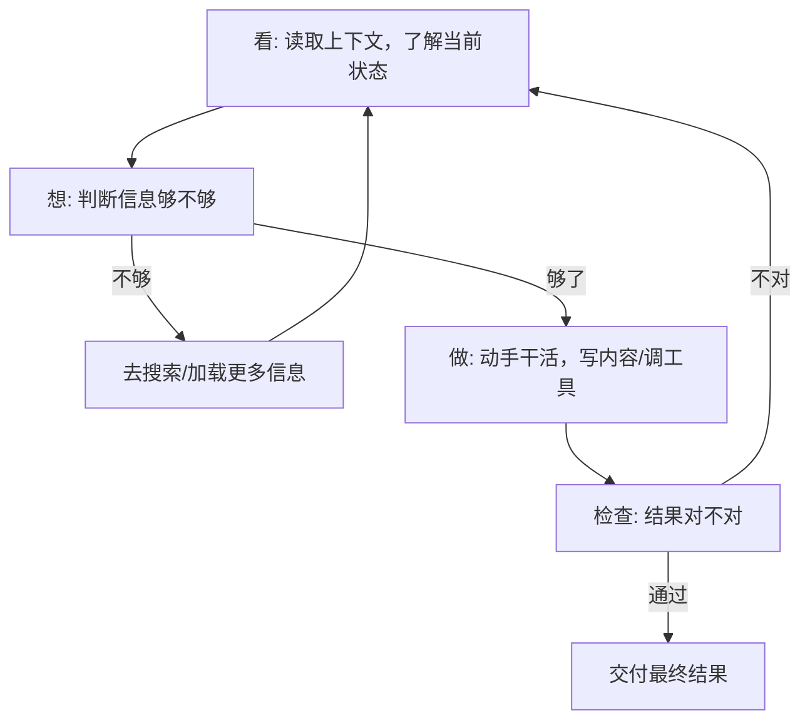

前四篇讲了三层：

- 提示词：怎么问
- 上下文工程：让 AI 看见什么
- Harness 工程：让 AI 能干什么、不能干什么

这三层有一个共同特点：**都是人搭好了，AI 来用。** 人写提示词，人准备上下文，人搭工作台。AI 只是使用者。

第四层不一样。它做的是——**让 AI 自己驱动自己。** 人搭好基础之后，就不再每轮都参与了。

## 它是什么

核心是一个**四步循环**。AI 自己跑，一轮一轮转：

1. **看**：看看现在是什么情况。读完摘要，看看上下文，知道要干什么
2. **想**：判断当前的信息够不够。够了就动手，不够就去找更多信息
3. **做**：动手干活。写一段内容，搜一个资料，改一个错误
4. **检查**：看看做出来的东西对不对。不对就回到第 1 步，带着新信息再转一轮

这个循环没有终点——每轮检查出来的问题，变成下一轮的输入。一轮比一轮好，直到检查通过 ^[Addy Osmani, Google Chrome 工程师, 2026 年 6 月命名 "Loop Engineering"]; ^[人人都是产品经理, "AI 工程的第四次跃迁", https://www.woshipm.com/ai/6414536.html]。

这个概念出来之后，Anthropic 的 Claude Code 负责人说了一句很有名的话："我已经不给 AI 写提示词了。我让循环在跑，循环自己去写提示词、自己去判断该干什么。" ^[Boris Cherny, Anthropic Claude Code 负责人, 2026 年公开演讲]; ^[Peter Steinberger, OpenClaw 创始人, 2026 年 6 月 7 日]。

## 跟你用过的有什么不同

你用过 ChatGPT 吧？你问一句，它答一句。你看了答案，觉得不行，再改问题重问。这叫**人驱动循环**——你是那个"看、想、检查"的人，AI 只负责"做"。

Loop 工程做的事：把"看、想、检查"也交给 AI。你对 AI 说"帮我写一篇关于某某的文章"，它自己写，自己检查，自己改，改到满意了再给你。你不需要盯着它改。

## 一个你正在看的例子

你现在读的这篇笔记，就是 Loop 工程的产物：

- 我先写了一版
- 两个审查助手自动检查：一个看小白能不能读懂，一个核实事实对不对
- 检查出来问题，我带着反馈重写
- 再审，再改，直到通过

人在哪？人一开始定了方向（"写 Loop 工程的笔记"），后面全是系统自己在转。这就是 Loop 工程的本质——人定方向，系统自己跑到终点。

## 四层串起来

回头看这四篇，其实是一条线：

- 提示词：你对 AI 说的第一句话（"帮我做某事"）
- 上下文工程：AI 自动收集做这件事需要的资料
- Harness 工程：AI 在规定的范围内用规定的工具干活
- Loop 工程：AI 干完自己检查，不好自己改，直到好了再交给你

四层加起来，人只需要做一件事：**说清楚要什么。** 剩下的系统自己搞定。

## 相关笔记

- [[概念-Harness工程]] — 上一层：给 AI 搭工作台
- [[Ch12 Prompt 工程]] — 回到起点：提示词是一切的开端
- [[知识图谱]] — 看全景：四条演化轴完整版

## 下一步

- [[概念-Harness工程]] — 上一层：给 AI 搭工作台
- [[Ch12 Prompt 工程]] — 回到起点：提示词是一切的开端
- [[知识图谱]] — 看全景：四条演化轴完整版

## 来源

- Addy Osmani (Google Chrome), 2026 年 6 月命名 "Loop Engineering"
- Boris Cherny (Anthropic Claude Code 负责人), 2026 年公开演讲
- Peter Steinberger (OpenClaw 创始人), 2026 年 6 月 7 日
- 人人都是产品经理, "AI 工程的第四次跃迁：从 Prompt 到 Loop", https://www.woshipm.com/ai/6414536.html
