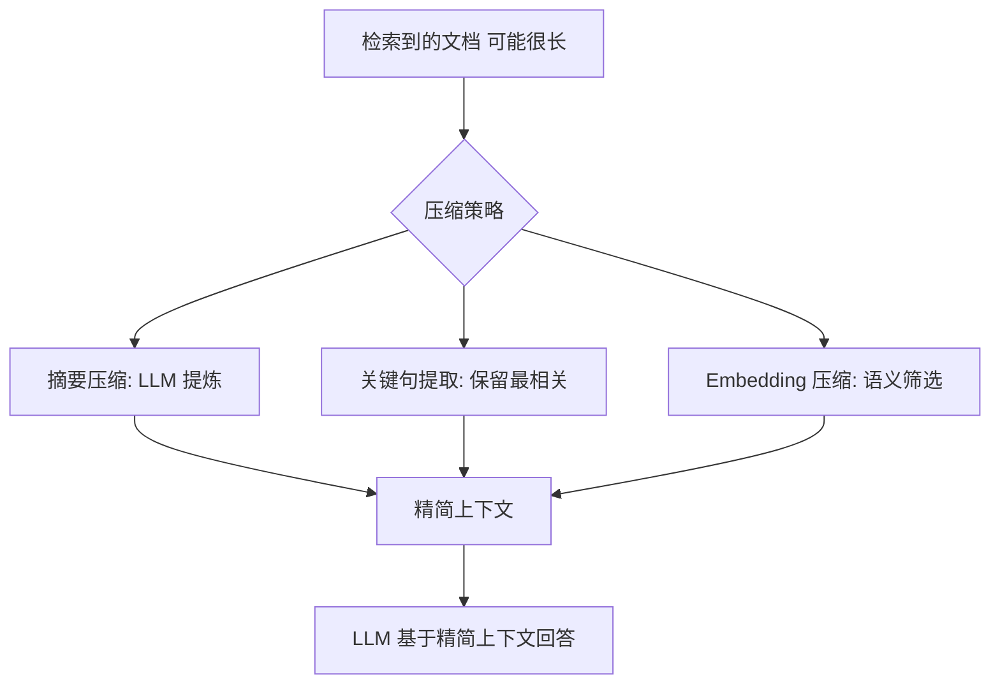

[[概念-上下文管理]] 提到对话太长时需要压缩。这篇深入两种压缩策略：提取式（保留关键句）和生成式（重写摘要）。以及它们各自的适用场景。

## 为什么不能直接截断



最简单的办法：对话太长？只保留最近 10 轮，前面的丢掉。

问题：用户在第 3 轮说"我是律师"，第 15 轮说"帮我审这份合同"。截断后，AI 不知道他是律师——回答可能不够专业。

**截断丢的是信息。压缩保的是含义。**

## 提取式压缩：保留关键句

像荧光笔划重点——从原文中挑出最重要的句子，剩下的丢弃。

**LLMLingua**（微软 2023 年开源）是这个领域的代表 ^[Jiang et al., "LLMLingua: Compressing Prompts for Accelerated Inference", 2023, https://arxiv.org/abs/2310.05736]。做法：

1. 把对话历史输入一个轻量 AI
2. AI 计算每个句子对"理解这段对话"的重要程度（困惑度）
3. 保留重要度最高的句子，丢弃说明、寒暄、重复
4. 输出压缩后的版本

压缩率：10 倍——1000 字的对话压到 100 字，保留核心信息。

**适用场景**：对话历史压缩、长文档摘要。不适合需要精确细节的场景（合同条款、技术规范）。

## 生成式压缩：重写摘要

不是从原文挑选句子，而是让 AI 读完原文后**重新写一段摘要**。

```
原文：20 轮对话，用户和 AI 讨论了一份合同的各种条款修改
摘要："用户是律师，正在审查一份软件授权合同。修改了第 3 条（价格）和第 7 条（违约责任）。用户要求加一条 GDPR 合规条款。AI 建议咨询法务确认。"
```

生成式压缩比提取式更短、更结构化。但代价是：**可能丢失细节或引入错误。** 如果 AI 在摘要里写错了价格（"100 万"写成了"1000 万"），后面所有对话都基于这个错误信息。

**适用场景**：摘要需要简洁易懂——给人看、给 AI 当记忆都是好选择。不适合需要精确保留原文字的场景。

## 提取 + 生成：混合方案

2026 年最佳实践是两者结合：

1. **提取**重要段落（保留原文措辞，避免失真）
2. **生成**结构化的关键信息摘要（日期、金额、决定）
3. AI 同时看到原文片段和结构化摘要

既保护了精确信息（提取的原文），又提供了概览（生成的摘要）。

## LLMLingua 实践

```python
from llmlingua import PromptCompressor
compressor = PromptCompressor(model_name="microsoft/llmlingua-2-bert")
compressed = compressor.compress_prompt(
    long_conversation,
    rate=0.5,  # 压缩到 50%
    target_token=500  # 不超过 500 tokens
)
```

2026 年更新：LLMLingua-2 比第一代快 3 倍，质量更好。支持中文。

## 对话压缩的特殊问题

**问题 1：最后几轮不能压缩。** 最近 3-5 轮的对话有完整的上下文连贯性。压缩会破坏这种连贯性。做法：只压缩 N 轮之前的对话，保留最近 N 轮不动。

**问题 2：用户偏好信息优先级最高。** "我是律师""我讨厌长篇大论"——这类信息必须保留，不管它出现在对话的哪个位置。做法：给这类信息打标，压缩时优先保护。

**问题 3：跨对话的关联。** 用户今天说的东西，跟三天前的对话有关联。做法：不只是压缩当前对话，还要检索历史相关对话，把关键信息拼进来。

## 相关笔记

- [[概念-上下文管理]] — 压缩是四种管理策略之一
- [[深挖-Agent记忆]] — 压缩是记忆系统的核心操作
- [[概念-上下文工程]] — 写选压隔 中的"压"

## 来源

- Jiang et al., "LLMLingua", 2023, https://arxiv.org/abs/2310.05736
- LLMLingua GitHub, https://github.com/microsoft/LLMLingua
