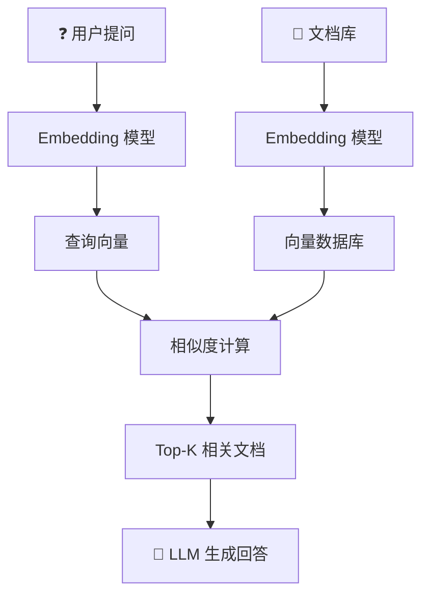

[[深挖-稀疏检索]] 解决了"搜到包含关键词的文档"。但它不懂语义——"头疼"和"头痛"对它来说是两个不同的词。稠密检索用 Embedding 解决了这个问题。

## Embedding 是什么

一句话：**把文字变成一串数字。** 这串数字有几个关键特性：

1. **固定长度。** 不管原文是一句话还是一本书，Embedding 出来的向量长度都一样（比如 768 或 1536 维）
2. **语义相近 = 向量相近。** "今天天气真好"和"今天天气不错"的向量，在数学上的余弦距离会很近
3. **语义不同 = 向量远离。** "今天天气真好"和"如何修水管"的向量会离得很远

这就是稠密检索的核心——**把"搜关键词"变成了"搜含义"** ^[Reimers & Gurevych, "Sentence-BERT: Sentence Embeddings using Siamese BERT-Networks", 2019, https://arxiv.org/abs/1908.10084]。



## Embedding 模型

不是随便一串数字就叫 Embedding。需要一个专门的模型来生成。

**2023 年主流：**
- OpenAI text-embedding-ada-002：1536 维，闭源，通过 API 调用
- bge-large-zh：1024 维，开源，中文效果很好

**2024 年升级：**
- OpenAI text-embedding-3：可调节维度（256-3072），成本降到 ada-002 的 1/5
- bge-m3：支持多语言，100+ 语言一个模型搞定

**2025-2026 年新秀：**
- Jina embeddings v3：支持长文本（8192 tokens），多语言
- Cohere embed v3：支持多向量（一个文档生成多个向量，不同段落可以分别匹配）

选择建议：如果自己做 RAG 系统，2026 年优先用 bge-m3（开源免费）或 text-embedding-3（便宜好用）。不要用 2022 年的老模型 ^[MTEB Leaderboard, https://huggingface.co/spaces/mteb/leaderboard]。

## 怎么搜

1. 把所有文档提前用 Embedding 模型处理一遍，变成向量，存进向量数据库
2. 用户提问时，把问题也变成向量
3. 在向量库里找和问题向量最接近的 Top-K 个文档
4. 把这 K 个文档的内容塞给 AI，让它基于这些内容回答

## 为什么比 BM25 好

| | BM25 | Embedding |
|---|---|---|
| "头疼"搜到"头痛" | 搜不到 | 能搜到 |
| "苹果手机"搜到"iPhone" | 搜不到 | 能搜到 |
| "怎么修水管"搜到"管道维修指南" | 搜不到 | 能搜到 |
| "iPhone 15 Pro 256GB" | 精确命中 | 可能混淆型号 |
| 搜产品型号/代码/ID | 精确 | 可能漂移 |

这就是为什么实际系统用**混合检索**——BM25 管精确，Embedding 管语义，两条路的结果合并 ^[StackAI, "Hybrid Search Best Practices", 2025]。

## Embedding 的成本

- **计算成本**：生成 Embedding 需要跑模型，比 BM25 慢。但可以预先计算——所有文档提前处理好，查询时只需要计算问题这一个向量
- **存储成本**：向量数据库需要存所有文档的向量。1536 维 × 100 万篇文档 × 4 字节 = 约 6GB
- **更新成本**：如果文档更新了，需要重新生成 Embedding

## 实践：用 bge-m3 生成 Embedding

（以下代码供有编程基础的读者参考。零基础读者可跳过，不影响理解本节内容。）

```python
from sentence_transformers import SentenceTransformer
model = SentenceTransformer("BAAI/bge-m3")

docs = ["今天天气真好", "如何修理漏水的水管"]
doc_vectors = model.encode(docs)
query = "怎么能修水管？"
query_vector = model.encode([query])

from sklearn.metrics.pairwise import cosine_similarity
scores = cosine_similarity(query_vector, doc_vectors)
# scores[0][1] > scores[0][0] — "修水管"的相似度更高
```

**Benchmark 参考**：在 MTEB（Embedding 模型评测排行榜）上，bge-m3 的平均检索准确率（NDCG@10）约为 63。OpenAI text-embedding-3-large 约为 65，但前者免费。

## 局限

Embedding 也有搞不定的场景：
- **精确 ID/代码**：见 [[深挖-稀疏检索]]
- **多跳推理**："张三的老板的老板是谁"——需要 Graph RAG
- **实时信息**：Embedding 是预计算的，不知道今天的新闻

## 相关笔记

- [[深挖-稀疏检索]] — BM25 弥补 Embedding 的精确匹配缺陷
- [[深挖-混合检索]] — 两路合一，2026 年标配
- [[Ch13 RAG 进化树]] — 稠密检索是第二代

## 来源

- Reimers & Gurevych, "Sentence-BERT", 2019, https://arxiv.org/abs/1908.10084
- MTEB Leaderboard, https://huggingface.co/spaces/mteb/leaderboard
- StackAI, "Hybrid Search Best Practices", 2025
