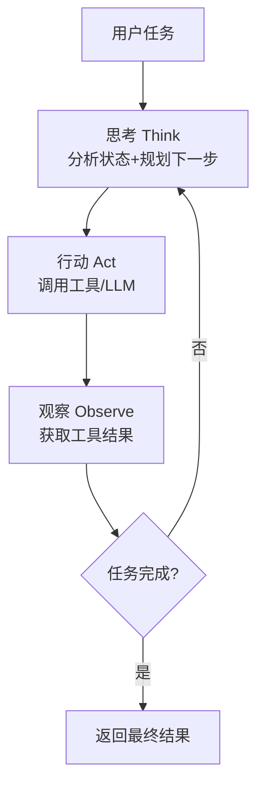

## 概念：像私人助理一样的 AI

Agent 和普通 AI 的关键区别在于：它不只是"回答"，而是主动"干活"。

把普通 AI 想象成**自动售货机**（投币-出货-结束），Agent 则更像**私人助理**——你跟助理说"下周三帮我安排去上海的出差"，助理不会只回一句"好的，出差"。她会自己查航班、比价格、订酒店、在日历上标记行程、提醒你带什么东西。你不必每一步都盯——你给任务，她跑流程，最后给你结果。

Agent 的工作方式是循环的，不是一次性的：

1. **看（Think）**：理解你的任务是什么，当前处于什么状态
2. **想（Plan）**：判断需要哪些信息、哪些工具、分几步做
3. **做（Act）**：调用工具、搜索资料、写代码、读文件
4. **检查（Observe）**：看结果对不对。不对？回到第 1 步再来

这个四步循环（Think-Plan-Act-Observe）是 Agent 的核心机制。学术界最早的系统化 Agent 循环叫 **ReAct**（Reasoning + Acting，推理与行动交替，2022 年由 Google Research 提出），核心是三步交替：先想（推理下一步该做什么）、再做（执行动作）、再看结果（观察反馈后继续推理）。^[Yao et al., "ReAct: Synergizing Reasoning and Acting in Language Models", 2022, https://arxiv.org/abs/2210.03629] 本节的四步是教学简化版——把"规划"从"想"中单独拆分出来，把"检查"显式强调。有关 ReAct 的深入分析，见 [[深挖-ReAct循环]]。

## 教学：Agent 的三个核心能力

Agent 的循环能跑起来，靠的是三个互相配合的能力。这三者缺一不可：

| 能力 | 什么意思 | 生活类比 | 如果缺了会怎样 |
|------|---------|---------|-------------|
| **工具调用**（Tool Use） | 能使用外部工具：查天气、搜资料、运行程序、读写文件 | 助理能上网、打电话、用计算器 | Agent 变成"纸上谈兵"——能规划但无法执行 |
| **分步规划**（Planning） | 能把大任务拆成可执行的小步骤 | 助理把"安排出差"拆成查航班、订酒店、标日历 | Agent 对复杂任务无从下手，或步骤混乱导致失败 |
| **自我纠错**（Self-Correction） | 检查每一步的结果，不对就调整，不一条路走到黑 | 订的航班取消了，助理立刻找替代航班而不是干等 | Agent 发现错误后卡住，或重复错误动作进入死循环 |

这三个能力对应了普通 AI 的三大短板（不能查、不能验、不能做）：工具调用解决"不能做"，分步规划解决"不能拆"，自我纠错解决"不能验"。

关于工具调用，其技术基础是 Function Calling（函数调用）——模型输出结构化指令，由外部系统执行。详见 [[概念-FunctionCalling]] 和 [[概念-工具调用]]。

关于分步规划，2026 年主流方法包括思维链（Chain-of-Thought）、思维树（Tree-of-Thought）和 Plan-and-Solve。详见 [[14.6 Agent 的规划能力]]。

## 注意事项：循环不是"越多越好"

Agent 的循环能力是一把双刃剑。循环让 Agent 能处理复杂任务，但也带来了三个核心风险：

**死循环**：Agent 在"想→做→不满意→再想→再做"中无限循环，特别是当它对自己的输出永远不满意时。2026 年的标准对策：硬限制最大步数（通常 30 步）+ 循环检测（连续 3 次调用同一个工具且参数相同则强制终止）。^[Anthropic, "Building Effective Agents", 2024 年 12 月, https://www.anthropic.com/engineering/building-effective-agents]

**成本膨胀**：每次 Think-Act 循环都调用 LLM。以 2026 年一个中等复杂度的 Agent 任务（如"分析这份 50 页的报告并写摘要"）为例，API 成本约 $0.5-$5。如果循环因反复重试而翻倍，成本也翻倍。生产部署需要"早停"策略——任务基本完成时就停止，不追求完美。

**工具滥用**：Agent 可能对简单问题过度调用工具。用户问"今天几号"，Agent 却调用搜索引擎、时间 API、日历工具——三个工具回答一个不需要工具的问题。这表现为不必要的延迟和成本。

## 关联

- [[深挖-ReAct循环]] — ReAct 循环的深度技术解析
- [[概念-Agent原理与ReAct]] — Agent 原理与 ReAct 的关系
- [[概念-Loop工程]] — Agent 底层循环工程的实现细节
- [[14.3 举个例子]] — 下一节：用具体例子看 Agent 怎么干活
- [[14.6 Agent 的规划能力]] — 分步规划的深度展开

---

> ← 上一节：[[14.1 普通 AI-一问一答]] ｜ 下一节：[[14.3 举个例子]] →
