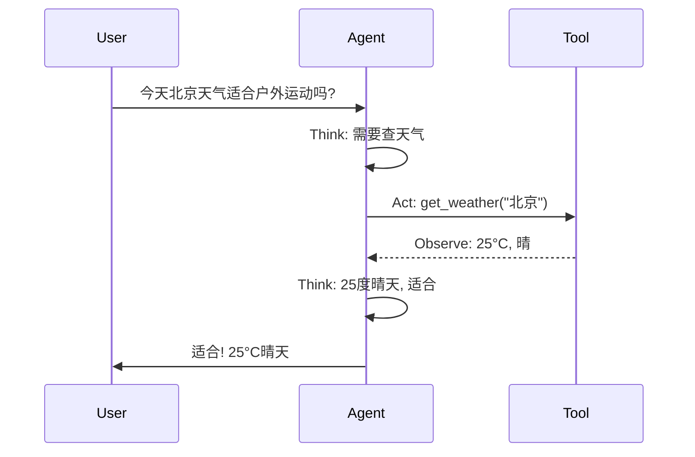

你对普通 AI 说："帮我查一下北京明天天气，如果下雨就提醒我带伞。"

普通 AI 会说："抱歉，我无法查询实时天气。"——没有工具，做不到。

Agent 的做法：

- 第 1 步（想）：需要查天气 -> 调用天气查询工具
- 第 2 步（做）：查到"明天北京晴转多云，不会下雨"
- 第 3 步（检查）：不会下雨 -> 不需要提醒带伞
- 第 4 步（回答）："明天北京晴转多云，不会下雨，不需要带伞。"

Agent 不只是回答问题——它**调用工具、分步执行、判断结果**。

---

> ← 上一节：[[14.2 Agent-多步自主执行]] ｜ 下一节：[[14.4 Agent 的三种工具使用模式]] →
