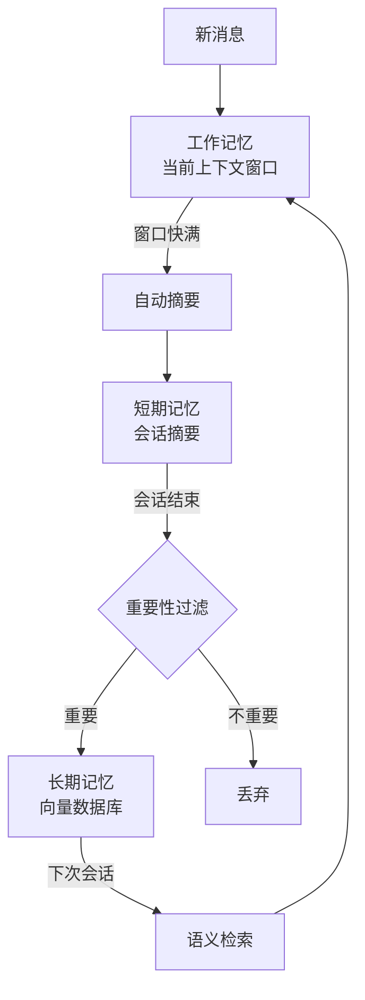

Agent 要在多轮交互中保持连贯性，靠的是记忆系统。记忆分三层，从"当下"到"持久"：

| 记忆类型 | 存储位置 | 生命周期 | 类比 | 实现方式 |
|---------|---------|---------|------|---------|
| 工作记忆 | 当前上下文窗口 | 单次对话 | 人脑"正在想的事" | 直接放在 prompt 里 |
| 短期记忆 | 会话内摘要/缓存 | 当前会话 | "刚才聊了什么" | 滑动窗口+自动摘要 |
| 长期记忆 | 向量数据库/知识库 | 跨会话持久化 | "我记得你之前..." | 向量检索+结构化存储 |

**工作记忆**就是当前对话的完整上下文。Agent 的每一步推理、工具调用结果、中间结论都放在这里。问题是上下文窗口有限——复杂任务可能跑着跑着就满了。解决：定期压缩（把旧消息替换成摘要）。

**短期记忆**是当前会话中"已经翻篇但可能需要回顾"的内容。比如前 10 轮对话的摘要、已完成子任务的结论。实现方式：当对话轮次超过阈值（如 20 轮），自动触发摘要，把旧内容压缩成一段话，存入短期记忆区。

**长期记忆**是跨会话的持久化存储。用户偏好（"我喜欢表格格式"）、历史任务经验（"上次搜这个关键词效果不好"）、学到的教训（"这个 API 不稳定，优先用另一个"）都存这里。2026 年的主流方案是用向量数据库（Pinecone、Chroma、Qdrant）存储记忆的 embedding，检索时用语义相似度找到最相关的记忆。

**记忆管理策略**需要回答两个问题：什么时候总结，什么时候遗忘。总结时机：token 使用量接近窗口上限的 80% 时触发自动摘要。遗忘策略：基于时间衰减（超过 30 天未访问的记忆自动归档）和重要性评分（用户明确标记为"重要"的记忆永不删除）。

---

> ← 上一节：[[14.4 Agent 的三种工具使用模式]] ｜ 下一节：[[14.6 Agent 的规划能力]] →
