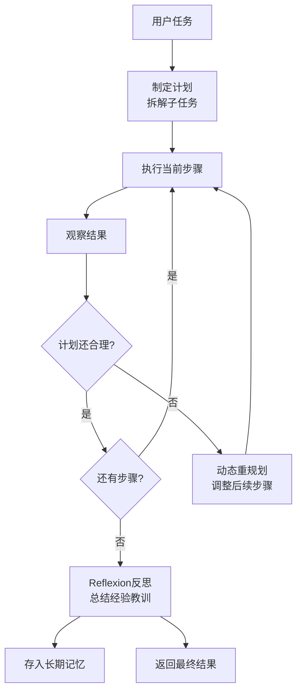

Agent 不是"想到哪做到哪"——好的 Agent 在行动前会先规划，执行中还会调整。

**任务分解（Decomposition）**：把大任务拆成可执行的小步骤。常用方法：
- **Chain-of-Thought（思维链）**：让模型在推理时"一步步想"，比如"要做竞品分析，我需要先搜索产品信息，然后分析定价策略，最后对比优劣势"
- **Tree-of-Thought（思维树）**：不只一条路，而是同时探索多条推理路径，每条路径走几步后评估，淘汰差的，深化好的。2023 年由 Yao 等人提出，适合需要"回溯"的复杂推理任务 ^[Yao et al., "Tree of Thoughts", 2023, https://arxiv.org/abs/2305.10601]
- **Plan-and-Solve**：先让模型生成完整计划，再逐条执行。比 Chain-of-Thought 多了"先规划全局再看细节"的视角

**动态重规划（Replanning）**：执行中发现新信息时，不是死守原计划，而是调整。比如原计划"搜 A 公司产品 - 分析定价"，但搜的过程中发现 A 公司刚被收购了——重规划：先确认收购消息，再分析收购后的产品策略变化。关键机制是每次观察（Observe）后，不只判断"下一步做什么"，还判断"之前的计划还对不对"。

**规划失败处理**——Agent 最常见的三种失败和应对：
- **超时/超步数**：设置最大执行步数（如 30 步），超过则强制终止并返回"部分结果 + 说明未完成原因"
- **死循环**：检测重复动作——连续 3 次调用同一个工具且参数相同？强制切换策略或终止。更高级的做法是单独跑一个"监控 Agent"来检测循环
- **工具不可用**：逐级降级——重试（等 2 秒再试）-> 换参数（换个关键词）-> 换工具（API 挂了用网页搜索）-> 问用户（"XX 工具暂时不可用，是否继续？"）

**Reflexion（自我反思）机制**：2023 年由 Shinn 等人提出，在传统 ReAct 循环后加一个"反思"环节 ^[Shinn et al., "Reflexion: Language Agents with Verbal Reinforcement Learning", 2023, https://arxiv.org/abs/2303.11366]。任务完成后（或失败后），Agent 自我反问："我哪里做得好？哪里做得不好？下次遇到类似任务该怎么做？"反思结果存入长期记忆。下一次遇到类似任务时，Agent 先检索相关反思，避免重蹈覆辙。

---

> ← 上一节：[[14.5 Agent 的记忆系统]] ｜ 下一节：[[14.7 Agent 的工具设计]] →
