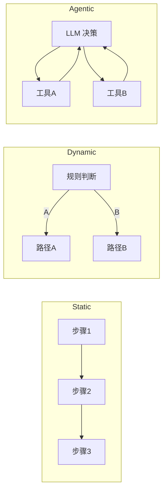

你在 [[Ch14 Agent 工作原理]] 里看到 Agent（能自己干活的 AI）能自己规划步骤。但步骤之间的连接方式不止一种——有的像流水线，有的像岔路口，有的完全让 AI 自己决定。这三种连接方式，就叫工作流（Workflow）模式。

（说明：以下三种分类是面向初学者的教学简化，实际工具（如 LangGraph）的实现方式更灵活，支持三种模式的混合使用 ^[LangChain, LangGraph 官方文档]）。

## 模式一：固定流程

就像一个工厂流水线。每一步做什么，是提前定好的，不会变。

例子：写一份周报
- 第 1 步：收集本周的工作记录
- 第 2 步：按模板整理格式
- 第 3 步：检查字数是否达标
- 第 4 步：发送给领导

每一步都是固定的。中间不会跳出新需求，也不会跳过某一步。适合：步骤明确、不需要临场判断的任务。

这种模式叫 **Static Workflow**（固定工作流）^[LangChain, "Workflow Patterns", https://langchain.com]。

## 模式二：岔路口

就像一个交通导航。主干道是定好的，但遇到岔路口可以根据条件选择不同的路。

例子：客服系统
- 先判断：用户是来投诉的、还是来咨询的？
- 投诉 -> 转人工客服
- 咨询 -> AI 自动回答
- 如果 AI 回答不了 -> 转人工客服

这个流程有分支，但分支逻辑是提前写好的——"如果 X 就做 A，如果 Y 就做 B"。适合：场景明确、但需要根据不同情况走不同路径的任务。

这种模式叫 **Dynamic Workflow**（动态工作流）^[LangGraph, https://langchain.com/langgraph]。

## 模式三：AI 自己决定

就像一个聪明的助理。你只告诉它目标，具体怎么做、走什么路径——它自己判断。

例子：写一篇关于 AI 的文章
- Agent 先搜索资料
- 搜出来的资料不够 -> 换个关键词再搜
- 搜够了 -> 列大纲
- 写到一半觉得某段需要数据支撑 -> 自己决定再搜一次
- 写完自己检查一遍 -> 修改 -> 再检查 -> 通过

这个流程没有预先定好的步骤。每一步做什么，是 Agent 根据上一步的结果自己决定的。适合：开放任务，步骤不可预知。

这种模式叫**自主工作流**（Agentic Workflow）——也就是 [[概念-Loop工程]]（让 AI 自己循环改进）的实践。

## 一张表看懂三种模式

| | 固定流程 | 岔路口 | AI 自己决定 |
|---|---|---|---|
| 谁决定步骤 | 人提前定好 | 人提前定好分支逻辑 | AI 自己决定 |
| 能转弯吗 | 不能 | 能，但转弯方向是提前定的 | 能，转弯方向 AI 自己判断 |
| 适合什么 | 简单重复任务 | 有明确规则的复杂任务 | 开放式任务 |
| 举例 | 生成周报 | 客服路由 | 写文章、改 bug |

## 怎么选

- 任务步骤明确、不会变 -> 固定流程
- 任务有几种明确的走向 -> 岔路口
- 任务太开放、不知道怎么走 -> 交给 AI 自己决定

三者可以组合。很多实际系统是"固定流程 + 岔路口 + 某些步骤交给 AI"——最灵活的部分用自主模式，最稳定的部分用固定模式。

## 跟你有什么关系

你不需要自己写 Workflow 引擎。但你用到的很多 AI 产品，底层就是这三种模式的组合。理解了这三种模式，你就能判断：

- 为什么某些 AI 产品很"死板"——它的 Workflow 是固定的
- 为什么某些 AI 产品很"灵活"——它用了自主模式
- 为什么某些 AI 产品又灵活又不会出错——它把固定和自主组合得很好

## 相关笔记

- [[Ch14 Agent 工作原理]] — Workflow 是 Agent 的骨架
- [[概念-Loop工程]] — 自主 Workflow 就是 Loop 的落地
- [[概念-上下文管理]] — Workflow 需要上下文管理来记住状态

## 来源

- LangChain, "Workflow Patterns", https://langchain.com
- LangGraph, https://langchain.com/langgraph
