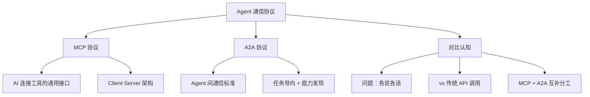

你在 [[Ch14 Agent 工作原理]] 里看到 Agent（能自己干活的 AI）能用工具、能自己规划。但不同公司做的 Agent 怎么互相配合？就像不同品牌的手机需要统一的充电接口一样，Agent 之间也需要统一的标准。两个最重要的标准就是 MCP 和 A2A。

## 为什么这个问题重要

在你还没感知到的地方，这些协议已经在改变 AI 的工作方式：

- 你用的 AI 编程工具（Claude Code、Cursor），背后可能有多个 Agent 在协作——一个搜资料，一个写代码，一个检查代码质量——它们靠 A2A 通信
- 你用的 AI 搜索，检索部分的工具调用用的可能就是 MCP 标准
- 以后你可能只需要一个"总管 Agent"，你跟它说需求，它自己协调十几个专业 Agent 来完成——MCP 和 A2A 是这个愿景的基础设施

## 2026 年双协议生态

MCP 由 Anthropic 于 2024 年 11 月发布，到 2026 年已成为 AI 连接工具的**事实标准** ^[Anthropic, MCP, 2024.11, https://www.anthropic.com/news/model-context-protocol]。主要支持者包括：**Claude Desktop**（Anthropic 官方桌面应用）、**Claude Code**（Anthropic 的 CLI 编程工具）、**Cursor**（AI 编程编辑器）、**Continue**（开源 AI 编程助手）、**Zed**（新一代代码编辑器）。截至 2026 年中，MCP 生态已有数千个开源 MCP Server，覆盖文件系统、数据库、云服务、开发工具和知识库等常见场景。

A2A 由 Google 于 2025 年 4 月发布，到 2026 年已成为 Agent 间通信的主流协议 ^[Google, A2A, 2025.04, https://developers.googleblog.com/en/a2a-a-new-era-of-agent-interoperability/]。主要支持者包括：**Google Agent Development Kit (ADK)**（Google 官方的 Agent 开发框架）、**LangChain**（最流行的 Agent 开发框架）、**CrewAI**（多 Agent 协作框架）、**Atlassian Rovo**（企业级 Agent 平台）。2025 年 8 月，IBM 的 ACP 协议并入 A2A，结束了"三标准并立"的局面，巩固了双协议分工 ^[Tyk, "Agent protocols: A complete guide to MCP, A2A, and ACP", 2026, https://tyk.io/learning-center/agent-protocols-a-complete-guide-to-mcp-a2a-and-acp/]。

MCP 和 A2A 解决不同层面的问题，**互补而非竞争**。一个典型的 AI 应用可能同时使用两个协议：Agent 通过 MCP 调用工具（查天气、搜资料、读写文件），同时通过 A2A 与其他 Agent 协作（搜索 Agent 把结果传给写作 Agent）。

## 本章目录

1. [[15.1 问题-每个 Agent 各说各话|15.1 问题：每个 Agent 各说各话]]
2. [[15.2 MCP-AI 连接工具的通用接口|15.2 MCP：AI 连接工具的通用接口]]
3. [[15.3 A2A-Agent 之间的通信协议|15.3 A2A：Agent 之间的通信协议]]
4. [[15.6 和传统 API 调用的区别|15.6 和传统 API 调用的区别]]

## 相关笔记

- [[Ch14 Agent 工作原理]] — 协议是 Agent 互操作的基础
- [[概念-MCP]] — MCP 架构与核心概念详解
- [[概念-A2A]] — A2A 架构与核心概念详解
- [[概念-MCP+A2A]] — 双协议协同使用指南
- [[对比-MCPvsA2A]] — MCP 与 A2A 详细对比
- [[对比-ToolUsevsFunctionCalling]] — 工具调用机制对比
- [[深挖-Agent安全]] — Agent 安全与沙箱
- [[深挖-结构化输出]] — 结构化输出如何让工具调用更可靠

## 跨章节关联

- [[Ch14 Agent 工作原理]] — MCP/A2A 的前置：Agent 原理
- [[Ch16 多 Agent 协作]] — 协议之后：多 Agent 如何协作
- [[Ch13 RAG 进化树]] — Agent 与 RAG 的结合：Agentic RAG

## 来源

- Anthropic, MCP, 2024.11, https://www.anthropic.com/news/model-context-protocol
- Google, A2A, 2025.04, https://developers.googleblog.com/en/a2a-a-new-era-of-agent-interoperability/
- a16z, "A Deep Dive Into MCP", 2025, https://a16z.com/a-deep-dive-into-mcp-and-the-future-of-ai-tooling/
- Atlan, "MCP vs API: When to Use Each", 2026, https://atlan.com/know/when-to-use-mcp-vs-api/
- Tyk, "Agent protocols: MCP, A2A, and ACP", 2026, https://tyk.io/learning-center/agent-protocols-a-complete-guide-to-mcp-a2a-and-acp/
