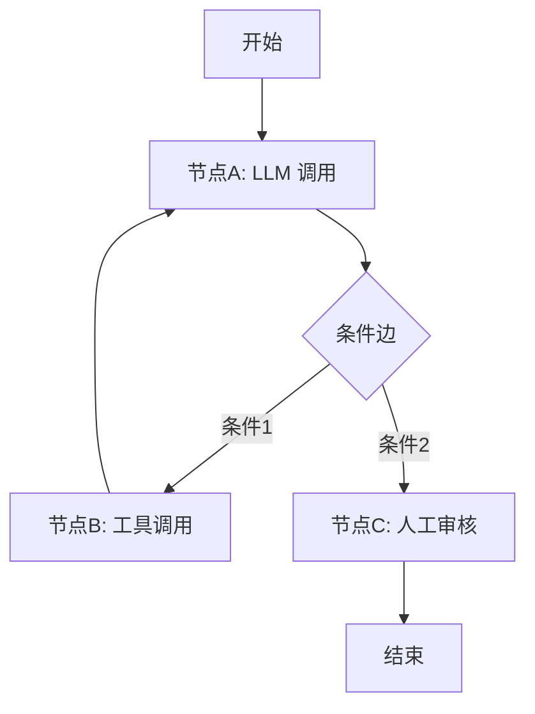

## 一句话理解

LangGraph 是 **LangChain 生态的图编排引擎**，用**有向图（Directed Graph）**定义 Agent 工作流。**节点（Node）是操作**（LLM 调用、工具调用、决策），**边（Edge）是条件转移**（完成 -> 下一步、条件判断 -> 分支）。它让 Agent 不再只是线性 Chain，而是支持**循环、分支、并行**的复杂控制流。

## 核心概念



### StateGraph（状态图）

`StateGraph` 是 LangGraph 的核心抽象。它定义了一个有状态的有向图：

```python
from langgraph.graph import StateGraph
from typing import TypedDict

class AgentState(TypedDict):
    messages: list       # 对话历史
    next_step: str       # 下一步
    final_answer: str    # 最终输出

graph = StateGraph(AgentState)
```

### Node（节点）

Node 是图中的执行单元，每个 Node 接收状态，处理后返回更新后的状态。

| 节点类型 | 说明 | 示例 |
|----------|------|------|
| LLM Node | 调用 LLM 生成回复 | `chat_model.invoke(messages)` |
| Tool Node | 调用外部工具 | `web_search(query)` |
| Decision Node | 根据状态决定下一步 | `should_continue(state)` |
| Human Node | 暂停等待人工输入 | `interrupt("请确认")` |

### Edge（边）

Edge 定义节点之间的转移关系：

| 边类型 | 说明 | 示例 |
|--------|------|------|
| 普通边 (Normal Edge) | 无条件转移 | `graph.add_edge("node_a", "node_b")` |
| 条件边 (Conditional Edge) | 根据状态选择下一节点 | `graph.add_conditional_edges("decision", router, {"a": "node_a", "b": "node_b"})` |
| 入口点 (Entry Point) | 图的起始节点 | `graph.set_entry_point("start")` |
| 终止点 (END) | 图的结束 | `graph.add_edge("final", END)` |

### 循环和分支

LangGraph 的核心优势是支持**循环（Loop）**和**分支（Branching）**。这是 LangChain 的线性 Chain 做不到的：

```
[开始] --> [LLM思考] --> [需要工具?]
                ^              |
                |              +--> [是] --> [调用工具] --> [返回结果] --+
                |                                                       |
                +-------------------------------------------------------+
                                     |
                                     +--> [否] --> [输出答案] --> [结束]
```

### Checkpoint（检查点）

Checkpoint 是 LangGraph 的状态持久化机制。它允许：
- 保存工作流中间状态
- 支持时间旅行（回溯到之前的状态）
- 支持 Human-in-the-loop（暂停-恢复）
- 支持错误恢复（失败后从 Checkpoint 重试）

## LangGraph vs LangChain：链 vs 图

| 维度 | LangChain | LangGraph |
|------|-----------|-----------|
| 控制流 | 线性 Chain（A -> B -> C） | 有向图（支持循环、分支、并行） |
| 状态管理 | 简单（Memory 模块） | 丰富（StateGraph + Checkpoint） |
| 循环 | 不支持 | 原生支持 |
| 条件分支 | 有限（RouterChain） | 完全支持（条件边） |
| Human-in-the-loop | 不支持 | 原生支持（interrupt） |
| 生产就绪 | 一般 | 高（持久化、可恢复、可观测） |
| 2026 年推荐 | 仅简单场景 | 新项目首选 |

## LangGraph vs CrewAI vs AutoGen 对比

| 维度 | LangGraph | CrewAI | AutoGen |
|------|-----------|--------|---------|
| 抽象层级 | 低（接近编程语言） | 高（角色扮演） | 中（对话抽象） |
| 控制流 | 显式图（确定性强） | 顺序/层级（确定性强） | 对话驱动（不确定性高） |
| 循环 | 原生支持 | 不直接支持 | 通过对话轮次隐式支持 |
| 并行 | 原生支持 | 通过 async_execution | 通过 GroupChat |
| 状态持久化 | Checkpoint 机制 | 有限 | 有限 |
| 调试难度 | 中（可追踪每个节点） | 低（日志清晰） | 高（对话流难以追踪） |
| 学习曲线 | 高（需要理解图编程） | 低 | 中 |
| 生产就绪 | 最高 | 中 | 中 |
| 2026 年推荐 | 生产级 Agent 首选 | 快速原型 | 企业级对话场景 |

## 代码示例：有循环的 Agent 工作流

```python
from langgraph.graph import StateGraph, END
from langgraph.checkpoint.memory import MemorySaver
from langchain_openai import ChatOpenAI
from typing import TypedDict, Annotated
import operator

# 定义状态
class AgentState(TypedDict):
    messages: Annotated[list, operator.add]
    iteration: int

llm = ChatOpenAI(model="gpt-5.5")  # 2026年推荐

# 定义节点
def think(state: AgentState):
    """LLM 思考节点"""
    response = llm.invoke(state["messages"])
    return {"messages": [response], "iteration": state["iteration"]}

def should_continue(state: AgentState):
    """决策节点：是否继续循环"""
    last_message = state["messages"][-1]
    if "FINAL_ANSWER" in last_message.content:
        return "end"
    if state["iteration"] >= 5:
        return "end"  # 防止无限循环
    return "continue"

def tool_call(state: AgentState):
    """工具调用节点"""
    # 实际项目中调用搜索、计算等工具
    return {"messages": [{"role": "tool", "content": "工具执行结果"}], "iteration": state["iteration"] + 1}

# 构建图
graph = StateGraph(AgentState)

graph.add_node("think", think)
graph.add_node("tool", tool_call)

graph.set_entry_point("think")
graph.add_conditional_edges("think", should_continue, {"continue": "tool", "end": END})
graph.add_edge("tool", "think")  # 回到 think，形成循环

# 编译并启用 Checkpoint
memory = MemorySaver()
app = graph.compile(checkpointer=memory)

# 运行
result = app.invoke(
    {"messages": [{"role": "user", "content": "分析这个数据集并给出结论"}], "iteration": 0},
    config={"configurable": {"thread_id": "session-1"}}
)
```

## 2026 年定位

LangGraph 在 2026 年的定位是：**生产级 Agent 系统的首选框架**。

- 优点：
  - 控制流精确：图结构使 Agent 行为可预测、可解释
  - 状态持久化：Checkpoint 机制支持暂停、恢复、重试
  - 可观测性：与 LangSmith 集成，追踪每个节点
  - 灵活性极高：可以构建任意复杂的 Agent 拓扑
  - 社区活跃：LangChain 团队持续投入，文档完善
- 缺点：
  - 学习曲线高：需要理解图编程、状态管理
  - 代码量大：简单任务也比 CrewAI 写得多
  - 抽象层级低：需要处理更多底层细节
- 典型场景：生产级 Agent 系统、复杂决策流程、需要可恢复性的长时间任务

## 相关笔记

- [[深挖-LangChain]] — LangGraph 的前身，线性 Chain 框架
- [[深挖-LangSmith]] — LangGraph 的可观测性平台
- [[深挖-Lang家族]] — Lang 家族全景
- [[深挖-CrewAI]] — 角色扮演式多 Agent 框架
- [[深挖-AutoGen]] — 微软对话式多 Agent 框架
- [[Ch15 Agent 通信协议]] — Agent 通信协议
- [[Ch16 多 Agent 协作]] — 多 Agent 协作模式

## 来源

- https://langchain-ai.github.io/langgraph/ — LangGraph 官方文档
- https://github.com/langchain-ai/langgraph — LangGraph GitHub 仓库
- https://blog.langchain.dev/langgraph/ — LangGraph 官方博客介绍
- https://docs.langchain.com/oss/python/langgraph — LangChain 文档中 LangGraph 部分