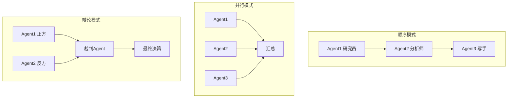

### 16.2.1 1. 流水线

每个 Agent 只做一件事，做完交给下一个。

```
搜索Agent -> 分析Agent -> 写作Agent -> 审查Agent
```

**适合**：步骤固定、有先后顺序的任务。比如写报告、处理文档。

**框架**：用 LangChain（一个 Python 框架，核心思想是把 LLM 调用和外部工具串成"链"——Chain，让开发者用几行代码就把"搜索→分析→写作"这样的流程编排起来）的 Chain 可以轻松实现。LangGraph（LangChain 生态中的图编排工具，专为复杂 Agent 流程设计，支持条件分支和循环——比如"搜完判断要不要再搜，写完后检查是否需要重写"）支持更复杂的流水线（带条件分支）。

### 16.2.2 2. 辩论

两个 Agent 对同一个问题给出不同答案，互相质疑，直到达成一致。

```
Agent A: "答案是 X，因为..."
Agent B: "不对，Y 更合理，原因是..."
Agent A: "你提到的 Y 有道理，但我认为..."
-> 收敛到共识
```

研究证明：多 Agent 辩论可以显著提高答案质量，减少幻觉。因为一个 Agent 的错误会被另一个 Agent 的推理纠正 ^[Du et al., "Improving Factuality and Reasoning in Language Models through Multiagent Debate", 2023, https://arxiv.org/abs/2305.14325]。

**适合**：需要高准确率的场景。数学证明、事实核查、法律分析。

### 16.2.3 3. 层级

一个总管 Agent 负责拆分任务、分配工作、合并结果。下属 Agent 各管一摊：

- 总管 Agent（分配任务）
- 搜索 Agent（搜资料）
- 分析 Agent（处理信息）
- 编程 Agent（写代码）

这是 2026 年最主流的多 Agent 架构。CrewAI 和 AutoGen 都是基于这个模式。

**适合**：任何复杂任务。总管负责"做什么"，下属负责"怎么做"。

### 16.2.4 4. 投票

同一个任务给 N 个 Agent 独立处理，取多数结果。

```
同一个问题 -> Agent 1: 答案A
            -> Agent 2: 答案A
            -> Agent 3: 答案B
-> 多数投票：答案A
```

**适合**：高可靠性场景。医疗诊断、金融风控。代价高——每条答案都要付费。

---

> ← 上一节：[[16.1 为什么需要多 Agent]] ｜ 下一节：[[16.3 多 Agent 架构模式深入]] →
