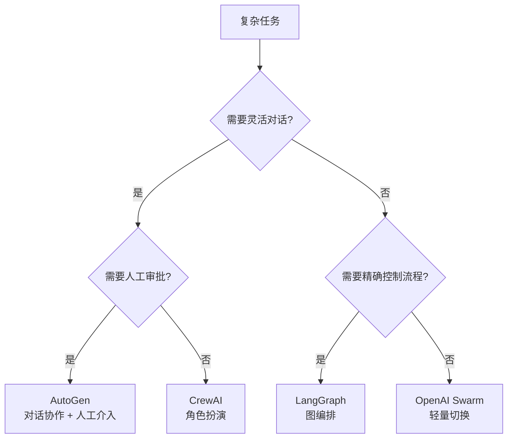

前面介绍了四种协作模式，这里深入每种模式的具体实现和代码示例。

### 16.3.1 顺序模式（流水线）

每个 Agent 是流水线上的一站，上游的输出是下游的输入。逻辑最简单，但容错性差——中间任何一站出错，整条线停摆。

**适用场景**：步骤固定、有明确先后顺序的任务。文档处理（OCR -> 翻译 -> 排版）、数据管道（采集 -> 清洗 -> 入库）、报告生成（搜索 -> 分析 -> 写作）。

**代码示例**（LangGraph 风格）：

```python
from langgraph.graph import StateGraph

# 定义三个 Agent 节点
def researcher(state):
    """搜索 Agent：根据主题搜索资料"""
    topic = state["topic"]
    results = search_tool.query(topic)
    return {"research_materials": results}

def analyst(state):
    """分析 Agent：从资料中提取关键信息"""
    materials = state["research_materials"]
    insights = llm.analyze(materials, focus="key_findings")
    return {"insights": insights}

def writer(state):
    """写作 Agent：根据分析结果写报告"""
    insights = state["insights"]
    report = llm.write(insights, style="professional")
    return {"final_report": report}

# 串联成流水线
graph = StateGraph(dict)
graph.add_node("researcher", researcher)
graph.add_node("analyst", analyst)
graph.add_node("writer", writer)
graph.add_edge("researcher", "analyst")
graph.add_edge("analyst", "writer")
graph.set_entry_point("researcher")
```

### 16.3.2 层级模式（管理者-执行者）

一个总管 Agent 负责拆分任务、分配工作、合并结果。下属 Agent 只负责执行，不关心全局。这是 2026 年最主流的多 Agent 架构。

**适用场景**：任何复杂任务。总管负责"做什么"，下属负责"怎么做"。特别适合任务结构不固定、需要动态调整的场景。

**代码示例**（CrewAI 风格）：

```python
from crewai import Agent, Task, Crew, Process

# 定义角色
manager = Agent(
    role="项目经理",
    goal="拆解任务并分配给合适的专家",
    backstory="你是一个经验丰富的项目经理，擅长任务分解和资源调配"
)

researcher = Agent(
    role="研究员",
    goal="深度搜索并收集相关资料",
    tools=[web_search, database_query]
)

analyst = Agent(
    role="分析师",
    goal="从数据中提取洞察和趋势",
    tools=[data_analysis, chart_generator]
)

# 总管分配任务
crew = Crew(
    agents=[manager, researcher, analyst],
    tasks=[task_definition],
    process=Process.hierarchical  # 层级模式
)
result = crew.kickoff()
```

### 16.3.3 辩论模式（多视角对抗）

多个 Agent 对同一个问题给出不同答案，互相质疑，直到达成共识或达到最大轮次。核心价值在于"一个 Agent 的错误会被另一个 Agent 的推理纠正"。

**适用场景**：需要高准确率的场景。数学证明（正反方推演）、事实核查（一方主张一方质疑）、法律分析（控辩双方辩论）、医疗诊断（多专家会诊）。

**代码示例**：

```python
def debate_round(agent_a, agent_b, question, max_rounds=5):
    """多轮辩论，直到收敛或达到最大轮次"""
    response_a = agent_a.respond(question)
    response_b = agent_b.respond(question)

    for round_num in range(max_rounds):
        # A 看到 B 的观点后回应
        response_a = agent_a.respond(
            f"对方认为：{response_b}\n请评价并修正你的答案"
        )
        # B 看到 A 的观点后回应
        response_b = agent_b.respond(
            f"对方认为：{response_a}\n请评价并修正你的答案"
        )

        # 检查是否收敛
        if consensus_reached(response_a, response_b):
            break

    return synthesize(response_a, response_b)
```

### 16.3.4 投票模式（多数决定）

同一个任务给 N 个 Agent 独立处理，取多数结果。简单粗暴但有效——前提是每个 Agent 的错误是独立的（不相关）。实现要点：每个 Agent 使用不同的 prompt 策略或不同的底层模型，确保投票不是"同一个模型投了 N 次"。

**适用场景**：高可靠性场景。医疗诊断（3 个医生独立诊断，取多数）、金融风控（多模型投票判断欺诈）、代码审查（多个审查员独立审查）。代价高——每条答案都要付费，N 个 Agent 就是 N 倍成本。

### 16.3.5 框架选择指南

理解了四种协作模式之后，下一个实际问题是：用什么框架来实现？2026 年有五个主流选择，各有侧重。

| 框架 | 协作模式 | 核心特点 | 2026 年推荐场景 |
|------|---------|------|----------------|
| CrewAI | 层级（角色扮演） | 快速原型，角色定义清晰，Python 几行代码即可搭建 | 中小团队快速搭建多 Agent 工作流 |
| AutoGen | 对话式协作 | 灵活，原生支持人工介入（Human-in-the-Loop），适合需要审批的工作流 | 企业数据分析、需要人工审核的决策流程 |
| LangGraph | 图编排 | 生产级，状态管理强，支持条件分支和循环，精确控制流程 | 企业级部署、需要精细控制流程的复杂场景 |
| OpenAI Swarm | 轻量级切换 | 极简的 Agent 切换和交接机制，实验用 | 快速实验、教学演示、原型验证 |
| Agno | 层级 + 共享记忆 | 2025 年新兴框架，内置共享记忆机制 | 需要 Agent 之间共享上下文的场景 |

选择框架的本质是选择"灵活度 vs 可控度"的平衡点：
- **CrewAI** 最像管理一个团队——定义角色、分配任务、按流程执行。简单直观，但灵活性受限。
- **AutoGen** 最像开一个讨论会——Agent 通过对话协商解决问题。灵活但对话轮次不可预测，token 成本较高。
- **LangGraph** 最像画一张流程图——你可以精确控制每一步的走向和条件。最强大也最复杂，学习曲线最高。

生活比喻：CrewAI 是一家标准化餐厅（厨师按固定菜单做菜），AutoGen 是一个开放厨房（厨师和食客边聊边调整菜品），LangGraph 是一条自动化流水线（每道工序精确控制，但改流程需要重新编程）。

**决策流程图：**



更详细的框架对比见 [[概念-MultiAgent]] 中的框架对比表，AutoGen 的深度解析见 [[深挖-AutoGen]]。

---

> ← 上一节：[[16.2 四种协作模式]] ｜ 下一节：[[16.4 怎么避免 Agent 之间扯皮]] →
