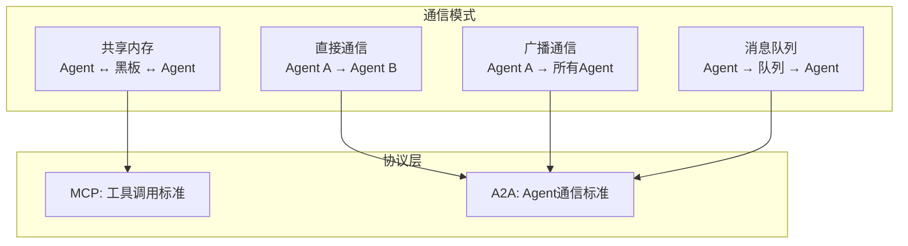

多 Agent 系统里，Agent 怎么互相传递信息？2026 年有五种主流通信模式：

**直接通信（Point-to-Point）**：Agent A 直接调用 Agent B。最简单，但耦合度高——A 必须知道 B 的存在和接口。适用于顺序模式和层级模式中的"总管 -> 下属"调用。

**广播通信（Broadcast）**：一个 Agent 发布消息，所有其他 Agent 都能收到。适用于"谁有空谁处理"的场景——总管发布子任务，空闲的下属 Agent 自己认领。类似消息总线的 Pub/Sub 模式。

**共享内存（黑板模式）**：所有 Agent 读写同一个共享空间。Agent A 写入中间结果，Agent B 读取后继续处理。优点是解耦——Agent 之间不需要知道彼此存在。缺点是并发控制复杂——两个 Agent 同时写同一个位置怎么办？2026 年的解决方案：用向量数据库或 Redis 做共享内存，加锁机制保证一致性。

**消息队列（Message Queue）**：Agent 之间通过消息队列异步通信。Agent A 发送消息到队列，Agent B 从队列中取消息。优点是异步解耦、削峰填谷。适合生产环境——Agent A 发完消息就可以继续干别的，不用等 Agent B 回复。

**通信协议选择**：Agent 之间用什么"语言"通信？
- **MCP（Model Context Protocol）**：Anthropic 2024 年底推出，主要用于 Agent 与工具之间的通信，但也可用于 Agent 之间传递结构化数据
- **A2A（Agent-to-Agent）**：Google 2025 年推出，专为 Agent 间通信设计，支持能力发现（Agent 可以询问"你能做什么"）、任务委派、结果返回
- **自定义协议**：简单场景直接用 JSON 传结构化数据，复杂场景用 Protobuf 或 gRPC

2026 年趋势：MCP 管"工具调用"，A2A 管"Agent 协作"，两者互补而非替代。大多数生产级多 Agent 系统同时使用两种协议。

---

> ← 上一节：[[16.4 怎么避免 Agent 之间扯皮]] ｜ 下一节：[[16.6 多 Agent 的挑战]] →
