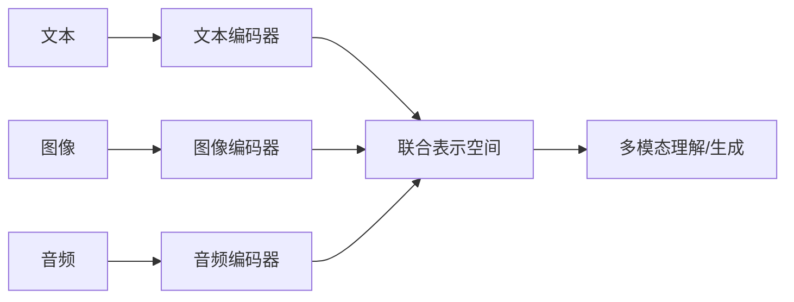

让 AI 同时理解文字和图片，听起来简单，实际上是 AI 领域最困难的问题之一。核心挑战叫做**模态对齐**——怎么让文字和图片在同一个"理解空间"里？

**问题**：文字是一串离散的 token（"猫"、"坐"、"在"、"桌子"、"上"），图片是一堆像素值（1024×1024×3 个数字）。它们是完全不同的"语言"。怎么让 AI 理解"这张图片里的猫"和"文字描述的猫"是同一个东西？

**解决方案的核心思想**：把不同模态的信息都映射到**同一个向量空间**。在这个空间里：
- 一张猫的图片 → 向量 [0.12, -0.45, 0.78, ...]
- 文字"一只猫" → 向量 [0.15, -0.42, 0.75, ...]
- 这两个向量非常接近（余弦相似度 > 0.9）

反过来，一张猫的图片和文字"一辆汽车"的向量距离很远。这就是模态对齐——让**相同含义**的多模态信息在向量空间中**靠近**，不同含义的**远离**。

**为什么这么难**：
- 文字和图片的"粒度"不同：一句话可以描述一个场景，也可以描述一个细节
- 图片包含大量冗余信息：一张猫的照片里有背景、光线、角度——AI 需要学会忽略这些，只关注"猫"
- 抽象概念的对齐：怎么把"自由"、"幸福"这种抽象概念和图片对应？CLIP 的解决方案是——让它看足够多的例子自己学会

---

> ← 上一节：[[17.1 什么叫多模态]] ｜ 下一节：[[17.3 多模态的四大核心挑战]] →
