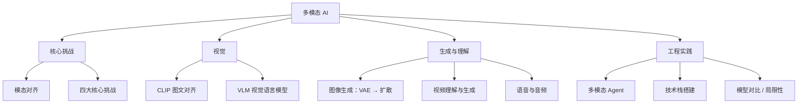

你用的 ChatGPT 可以看图、可以听你说话、可以跟你语音对话。它不是"一个人"在做这些事——是多个专门的 AI 在分工合作：视觉模型负责看懂图片，语音模型负责听懂说话，文字模型负责理解和生成文字，一个"调度器"决定什么时候用哪个模型。你感觉不到切换，因为调度器做得很快，像无缝衔接。这篇解释它们各自干什么、怎么串起来的。

> **生活比喻**：多模态 AI 像一位全能翻译——你给它看一张照片，它用"眼睛"（视觉模型）看懂；你给它说话，它用"耳朵"（语音模型）听懂；它用"嘴巴"（文字模型）回复你。它不是一个模型在干活，而是一个团队在背后无缝切换，你感觉不到换人。

## 本章目录

1. [[17.1 什么叫多模态|17.1 什么叫"多模态"]]
2. [[17.2 多模态的核心挑战-模态对齐|17.2 多模态的核心挑战：模态对齐]]
3. [[17.3 多模态的四大核心挑战|17.3 多模态的四大核心挑战]]
4. [[17.4 看图-CLIP 和视觉模型|17.4 看图：CLIP 和视觉模型]]
5. [[17.5 CLIP 深度解析-多模态 AI 的基石|17.5 CLIP 深度解析：多模态 AI 的基石]]
6. [[17.6 视觉语言模型（VLM）详解-从看图到对话|17.6 视觉语言模型（VLM）详解：从看图到对话]]
7. [[17.7 图像生成模型详解-从 VAE 到扩散模型|17.7 图像生成模型详解：从 VAE 到扩散模型]]
8. [[17.8 视频理解与生成-2026 年最热的前沿|17.8 视频理解与生成：2026 年最热的前沿]]
9. [[17.9 语音与音频-听和说的 AI|17.9 语音与音频：听和说的 AI]]
10. [[17.10 多模态 Agent-能看、能听、能做的 AI|17.10 多模态 Agent：能看、能听、能做的 AI]]
11. [[17.11 2026 多模态技术栈-从零搭建多模态应用|17.11 2026 多模态技术栈：从零搭建多模态应用]]
12. [[17.12 2026 年主流多模态模型对比|17.12 2026 年主流多模态模型对比]]
13. [[17.13 多模态应用场景|17.13 多模态应用场景]]
14. [[17.14 多模态的局限性|17.14 多模态的局限性]]

## 相关笔记

- [[Ch18 AI 创作这三年]] — 多模态在产品层的表现
- [[Ch14 Agent 工作原理]] — Agent 可以调度这些多模态工具

## 跨章节关联

- [[Ch19 多模态深度原理]] — 多模态的深层原理：CLIP、扩散、ViT
- [[Ch18 AI 创作这三年]] — 多模态技术如何驱动 AI 创作
- [[Ch07 CNN 与计算机视觉]] — 视觉 AI 的基础：CNN
- [[Ch09 Transformer 架构精讲]] — ViT：Transformer 的视觉应用

## 来源

- Radford et al., "CLIP", 2021, https://arxiv.org/abs/2103.00020
- OpenAI, "Whisper", 2022, https://openai.com/index/whisper/
- OpenAI, "Sora", 2024, https://openai.com/index/sora/
