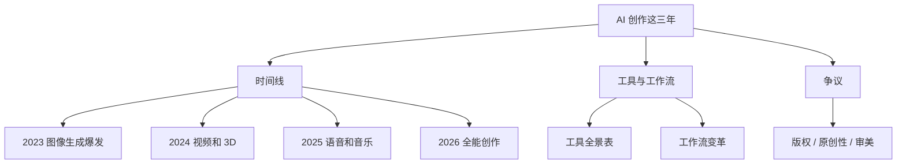

三年前，做一张图得会 Photoshop，做一段视频得会剪辑软件，做一首歌得会编曲。三年后，你输入一句话就行了。这篇梳理 AI 怎么把创作门槛从"专业技能"降到"会打字就行"。

你不需要学会这些工具的所有功能。你只需要知道：**创作的门槛已经从"技术"变成了"想法"。** 你有想法，AI 帮你实现。技术被 AI 抹平了，品味成了最后的护城河。

> **生活比喻**：AI 创作的演变像照相机的发展史——最早只有专业摄影师会用暗房（Photoshop），后来有了傻瓜相机（一键生成），到现在人人都有手机拍照（输入文字即可）。技术抹平了操作门槛，但构图和审美（品味）依然决定照片好坏。AI 帮你按快门，但拍什么、怎么拍，还是你做主。

## 本章目录

1. [[18.1 2023-图像生成爆发|18.1 2023：图像生成爆发]]
2. [[18.2 2024-视频和 3D 来了|18.2 2024：视频和 3D 来了]]
3. [[18.3 2025-语音和音乐爆发|18.3 2025：语音和音乐爆发]]
4. [[18.4 2026-全能创作|18.4 2026：全能创作]]
5. [[18.5 2026年AI创作工具全景表|18.5 2026年AI创作工具全景表]]
6. [[18.6 AI创作的工作流变革|18.6 AI创作的工作流变革]]
7. [[18.7 AI创作的核心争议|18.7 AI创作的核心争议]]

## 相关笔记

- [[产品-AI编程演变]] — 编程工具同样从辅助到自主
- [[产品-AI对话演变]] — 对话工具同样从打字到语音

## 跨章节关联

- [[Ch17 多模态 AI]] — 多模态技术是 AI 创作的引擎
- [[Ch19 多模态深度原理]] — 扩散模型、CLIP 等技术原理
- [[Ch12 Prompt 工程]] — AI 创作的第一步：写好提示词

## 来源

- Midjourney, https://www.midjourney.com
- OpenAI, DALL-E 3, https://openai.com/index/dall-e-3/
- OpenAI, Sora, https://openai.com/index/sora/
- Runway, Gen-3, https://runwayml.com
- Suno, https://suno.ai
- ElevenLabs, https://elevenlabs.io
