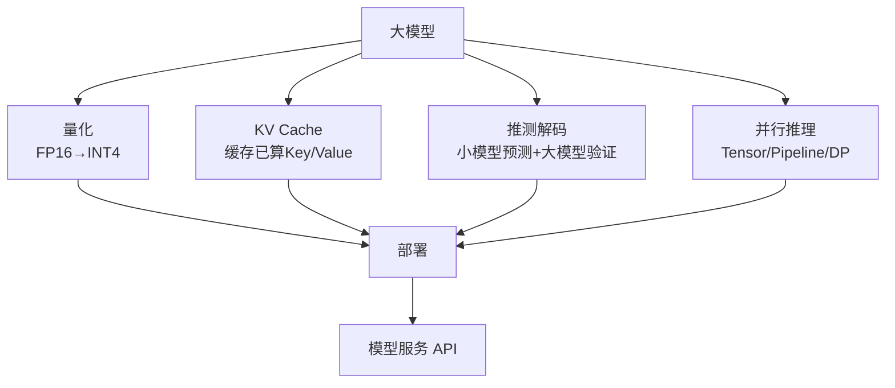

## 一台手机想跑 GPT，差了多少倍

一个 [[Ch10 LLM 原理与架构演进|GPT-4]] 级别的模型，完整运行需要几百 GB 的显存（显卡内存）。打个比方：一部高清电影大约 2GB，几百 GB 相当于一百多部高清电影同时塞进显存。而你的手机只有 8GB 内存，家用电脑通常 16-32GB，高端游戏显卡（如 RTX 4090）也只有 24GB 显存。差距在 10 到 50 倍。

为什么模型这么大？因为模型的"知识"存储在几十亿个参数（Parameter）里。参数就像大脑中神经元的连接强度——每个参数是一个数字，通常用 16 位浮点数（FP16，一种用 16 个 0/1 位表示小数的方式）存储。一个 70B（700 亿）参数的模型，光存参数就要 70 x 10^9 x 2 字节 = 140GB。这还不算推理时需要的额外显存——存储中间计算结果、缓存已生成的文本信息（KV Cache，见 [[20.7 推理优化技术深入|20.7 节]]），实际需要的显存通常是参数存储量的 2-3 倍。

这个问题在 AI 领域有一个专门的名字——**内存墙（Memory Wall）**：GPU 的计算速度（每秒能算多少次乘法）每年增长约 40%，但显存带宽（每秒能从显存读多少数据）每年只增长约 10%。算得再快，数据运不过来也是白搭 ^[Amir Gholami et al., "A Survey of Quantization Methods for Efficient Neural Network Inference", 2022, https://arxiv.org/abs/2103.13630]。推理场景尤其受内存墙限制——训练可以一次处理一大块数据（吞吐量大），推理却要一个个 Token 生成，大量时间花在从显存搬运参数上，GPU 的计算核心反而在"等数据"。

## 怎么把大象塞进冰箱：三条思路

要让大模型在普通硬件上跑起来，业界探索了三条核心思路：

### 思路一：量化——降低每个参数的精密度

这是最直接的方法。**量化（Quantization）**就是把参数的精度降下来。就像把一张 50MB 的无损照片压成 2MB 的 JPEG——画质肉眼几乎看不出差别，文件大小却只剩原来的几十分之一。

具体来说：原本每个参数用 16 位（FP16）存，量化到 4 位（INT4）后，存储量直接变成原来的四分之一。一个 70B 的模型从 140GB 降到约 35GB——刚好塞进一张 A100 显卡的 80GB 显存里。精度损失通常在 1-3% 以内（用困惑度衡量），对大多数应用几乎不可感知 ^[Elias Frantar et al., "GPTQ: Accurate Post-Training Quantization for Generative Pre-trained Transformers", ICLR 2023, https://arxiv.org/abs/2210.17323]。

量化的关键挑战在于：不是所有参数对精度的敏感度都一样。有些层（layer）的参数被压缩后模型性能暴跌，有些层压到 2 位也没事。这是因为某些层的参数存在"离群值"（Outlier）——某些通道的数值比平均值大几十倍，量化时这些大数值要么被"削顶"丢失信息，要么让其他小数值的精度更低 ^[Guangxuan Xiao et al., "SmoothQuant: Accurate and Efficient Post-Training Quantization for Large Language Models", ICML 2023, https://arxiv.org/abs/2211.10438]。[[20.2 几种常见的量化格式|20.2 节]]会具体讲不同的量化格式如何处理这个问题。

### 思路二：KV Cache——算过的不重算

Transformer 生成文本时，每生成一个新词，都要参考之前生成的所有词——这叫"注意力机制"。如果不做优化，生成第 1000 个词时要把前 999 个词的计算全部重做一遍。

KV Cache 的思路很简单：把已算过的 Key 和 Value（注意力机制的中间结果）存起来，下次直接用。就像考试时把之前的草稿纸留着，后面的题可以直接参考，不用每道题都从头推理。但代价是显存——缓存越长，占的显存越多。这是"长上下文"（能一次读几万字甚至整本书）模型需要大显存的核心原因 ^[Woomin Kwon et al., "Efficient Memory Management for Large Language Model Serving with PagedAttention", SOSP 2023, https://arxiv.org/abs/2309.06180]。

### 思路三：推测解码——小模型打草稿，大模型批改

让一个小模型（参数只有大模型的 1/10）快速生成几个候选词，然后大模型一次性验证这些词对不对。对就接受，不对就修正。因为验证可以并行做（一次检查好几个词），而生成只能一个一个来，整体速度能提升 2-3 倍。这在 [[20.7 推理优化技术深入|20.7 节]]有详细展开。

## 注意事项：压缩不是免费的午餐

量化和各种优化技术降低了部署门槛，但有几个坑需要知道：

**精度不是均匀损失的。** 量化对代码生成、数学推理这类需要精确逻辑的任务影响更大——因为这类任务对微小数字差异更敏感。对闲聊、摘要生成影响较小 ^[A Systematic Evaluation of On-Device LLMs: Quantization, Performance, and Resources, 2025, https://arxiv.org/abs/2505.15030]。

**量化后不一定更快。** 虽然量化减少了显存占用，但如果硬件没有针对低精度运算做优化，实际推理速度可能不升反降。比如 INT4 运算在老显卡上需要先"解压"回 FP16 再算，这比直接用 FP16 还慢。NVIDIA H100/H200 原生支持 FP8，INT4 在这些卡上才有明显的速度收益 ^[TensorRT-LLM Documentation, NVIDIA, 2025]。

**KV Cache 是双刃剑。** 缓存加速了推理，但显存消耗随上下文长度线性增长。一个 70B 模型处理 128K Token 的上下文，KV Cache 本身就要占几十 GB 显存。长上下文模型需要额外优化 KV Cache 的存储策略——比如对缓存的 Key/Value 也做量化（KV Cache Quantization），或者只缓存最重要的部分。

**模型质量 vs 硬件成本的取舍没有标准答案。** 2026 年的现状是：4 位量化是"无损压缩"的甜点位置——内存减少约 70%，精度损失几乎不可感知。2-3 位量化是最活跃的前沿——能把 70B 模型塞进 24GB 消费显卡，但需要更精细的处理来维持推理质量。2 位以下（子位量化）还是研究阶段。

## 关联到本章其他内容

- [[20.2 几种常见的量化格式]]：GGUF、AWQ、GPTQ 三种格式的具体对比
- [[20.3 怎么跑]]：Ollama、llama.cpp、vLLM 三种工具的实操指南
- [[20.7 推理优化技术深入]]：KV Cache、推测解码、FlashAttention 的深度原理
- [[概念-KV-Cache]]：KV Cache 的概念详解
- [[深挖-模型量化]]：量化的深入数学原理
- [[深挖-量化]]：量化技术的全面对比

---

> <- 上一节：[[Ch20 模型推理部署|章首]] ｜ 下一节：[[20.2 几种常见的量化格式]] ->
