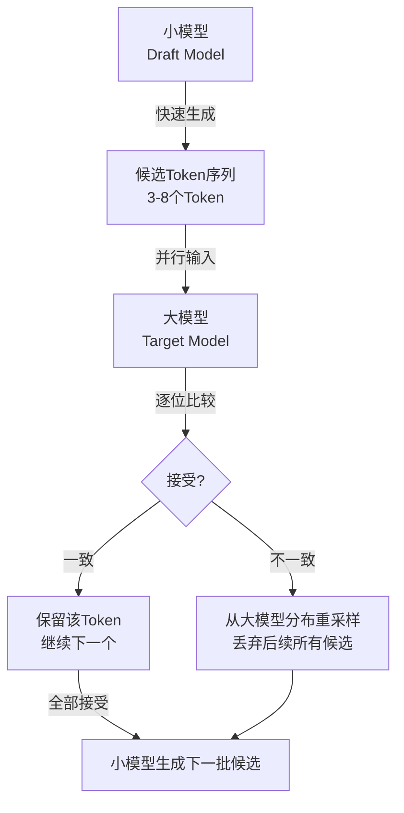

前面提到的量化、KV Cache、推测解码都是推理加速的核心技术。这里展开讲它们的工作原理。

### 20.7.1 KV Cache：为什么缓存 Key 和 Value 就能加速

Transformer 在生成每个新 Token 时，需要计算它与之前所有 Token 的"注意力"（Attention）。注意力机制的本质是：当前 Token 作为 Query，去查询之前所有 Token 的 Key，然后根据查询结果加权聚合它们的 Value。

问题在于：如果不做缓存，每生成一个新 Token，就要把之前所有 Token 的 Key 和 Value 全部重新算一遍。生成长度为 N 的序列，计算量是 O(N^2) 级别的——生成到第 1000 个 Token 时，需要把前 999 个 Token 的 Key/Value 全部重算一遍。

KV Cache 的思路很简单：**把已经算过的 Key 和 Value 存起来，下次直接用。** 每生成一个新 Token，只需要计算这个新 Token 的 Query、Key、Value，然后拿新 Query 去查缓存里的所有 Key，不需要重新计算历史 Key/Value。计算量从 O(N^2) 降到 O(N)。

代价是显存——缓存 1M Token 的 KV 对，在 FP16 下大约需要 2-4GB 显存（取决于模型层数和维度）。这也是为什么"长上下文"模型需要大显存的原因之一。

### 20.7.2 推测解码：小模型打草稿，大模型批改

推测解码（Speculative Decoding）是 2025-2026 年最主流的推理加速技术。它的核心洞察是：**生成一个 Token 需要跑完整的大模型，但验证一串 Token 对不对可以并行跑。**

具体流程分四步：

1. **小模型生成候选序列**：用一个参数只有大模型 1/10 到 1/20 的"草稿模型"（Draft Model），快速生成 3-8 个候选 Token。这一步很快，因为小模型的计算量小。
2. **大模型并行验证**：把候选序列一次性输入大模型，大模型并行计算每个位置的概率分布。并行是关键——验证 8 个 Token 的时间几乎和生成 1 个 Token 一样。
3. **逐个接受或拒绝**：从第一个 Token 开始，比较小模型和大模型的预测。如果一致，接受；如果不一致，从大模型的分布中重新采样，并丢弃后续所有候选 Token。
4. **重复**：用大模型接受的 Token 作为新起点，小模型生成新的候选序列。

在对话、代码生成这类"可预测性高"的任务中，推测解码的接受率能达到 70-90%，速度提升 2-3 倍。llama.cpp 和 vLLM 在 2025 年底均已内置支持。

### 20.7.3 FlashAttention：为什么分块计算更快

FlashAttention 是 2023 年提出的注意力计算优化算法，2025-2026 年已成为所有主流推理引擎的标配。它的核心洞察反直觉：**GPU 的瓶颈不是计算，而是显存读写。**

传统 Attention 计算有两个步骤：
1. 计算 Q x K^T 得到注意力分数矩阵（大小 N x N，N 是序列长度）
2. 对分数矩阵做 Softmax，再乘以 V

这个 N x N 的矩阵需要写入显存（HBM），再读出来。对于长序列，这个矩阵非常大——当 N=100K 时，光是这个矩阵就要 40GB 显存（FP16）。显存带宽（H100 约 3.35TB/s）成了瓶颈。

FlashAttention 的解法：**不把完整的注意力矩阵写入显存。** 把 Q、K、V 切成小块（Tiling），一块一块地计算 Softmax 的分子和分母，在 GPU 的片上内存（SRAM，比 HBM 快 10 倍以上）里完成计算，只把最终结果写回显存。通过数学上的重新推导（Online Softmax），确保分块计算的结果和全局 Softmax 完全一致。

效果：显存读写量减少 5-10 倍，长序列推理速度提升 2-4 倍，而且不损失任何精度。FlashAttention-3 在 2025 年发布，进一步针对 H100 的硬件特性做了优化。

---

> ← 上一节：[[20.6 2026 年推理部署新趋势]] ｜ 下一节：[[20.8 部署方案选型深入]] →
