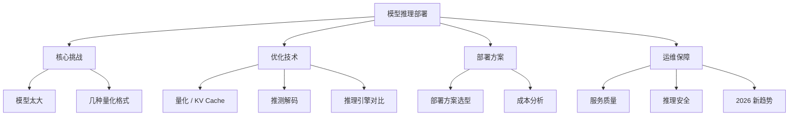

你一直在用 ChatGPT 和 Perplexity（AI 搜索工具）——它们是别人部署好的服务，你打开网页就能用。但如果你想自己在电脑上跑一个 AI，不用联网，怎么做到？这篇讲背后的技术。

把大象塞进冰箱有三条路：**量化**（降低参数精度，像高清照片压成 JPEG）、**KV Cache**（算过的不重算，像考试留着草稿纸）、**推测解码**（小模型打草稿大模型批改）。本章从"为什么模型大到跑不动"开始，逐步讲到量化格式、推理引擎、成本分析、安全隐私，直到你能自己搭一个推理服务。

> **生活比喻**：本地部署 AI 模型就像把大象塞进冰箱——量化是把大象压成压缩饼干（降低精度、减小体积），KV Cache 是记下之前算过的结果不重复算（草稿纸留着下次用），推测解码是先让小模型打草稿再让大模型批改（省时间）。三种方法一起用，才能把云端的大模型塞进你的笔记本电脑。

## 本章目录

1. [[20.1 问题-AI 模型太大了|20.1 问题：AI 模型太大了]]
2. [[20.2 几种常见的量化格式|20.2 几种常见的量化格式]]
3. [[20.3 怎么跑|20.3 怎么跑]]（含推理引擎对比速查表）
4. [[20.6 2026 年推理部署新趋势|20.6 2026 年推理部署新趋势]]（含手机端推理）
5. [[20.7 推理优化技术深入|20.7 推理优化技术深入]]
6. [[20.8 部署方案选型深入|20.8 部署方案选型深入]]（含快速选型速查表）
7. [[20.9 2026年推理成本分析|20.9 2026年推理成本分析]]
8. [[20.10 推理服务质量|20.10 推理服务质量]]
9. [[20.11 推理安全|20.11 推理安全]]

## 相关笔记

- [[概念-向量数据库]] — Faiss 和这些推理引擎一样，都是 AI 基础设施
- [[Ch14 Agent 工作原理]] — Agent 需要推理引擎来跑底层的 AI 模型

## 跨章节关联

- [[Ch11 模型微调]] — 微调完的模型怎么变小变快
- [[Ch10 LLM 原理与架构演进]] — 训练和推理的不同关注点
- [[Ch21 MLOps 基础]] — 模型部署后的运维：监控、更新、回滚

## 来源

- Ollama, https://ollama.com
- llama.cpp, https://github.com/ggerganov/llama.cpp
- vLLM, https://github.com/vllm-project/vllm
