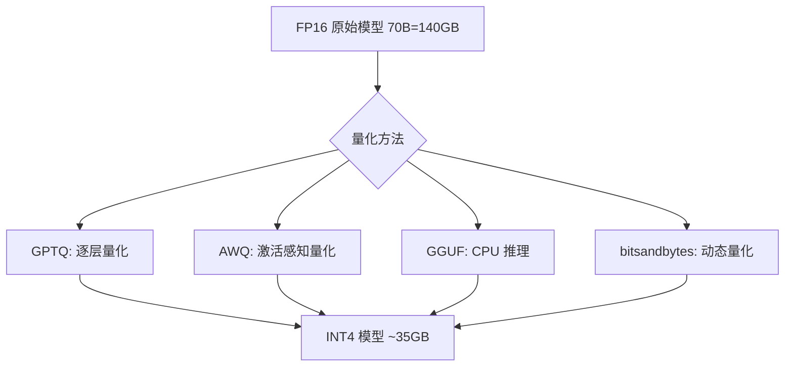

> 这篇是进阶内容。如果你刚接触 AI，先读 [[Ch20 模型推理部署|第20章]] 了解基本概念再回来看。

> **公式可跳过**：文中出现的量化参数（Q4_K_M 等）可以直接跳过，读文字和表格即可理解量化原理。

[[Ch20 模型推理部署]] 介绍了量化是把模型精度降低换空间。这篇深入三种主流方案的区别、原理和选型。

## 量化在做什么



模型参数默认用 16 位浮点数（FP16）存储。一个 70B 参数的模型，需要 70B × 2 字节 = 140GB 显存。

**量化就是把 16 位变成更少的位数**——8 位、4 位、甚至 2 位。每降一半位数，显存需求减半。

代价是精度损失。就像把高清照片压成 JPEG——4 位量化相当于"高压缩率 JPEG"，画面有点糊但基本能看。2 位量化相当于"极压缩"，能看个轮廓但细节丢失严重。

## GGUF：消费级硬件的标配

GGUF 是 llama.cpp 作者 Georgi Gerganov 设计的格式。核心特点：

**混合量化**：不是整模型统一量化。不同层的敏感度不同——注意力层对量化敏感（质量损失大），FFN 层不敏感。GGUF 允许给不同层设置不同的量化精度。

**不需要 GPU**：GGUF 专为 CPU 推理优化。量化后的模型可以在普通电脑甚至手机上跑。

**量化级别**：

| 级别 | 位宽 | 质量损失 | 适用 |
|------|------|---------|------|
| Q8_0 | 8-bit | 几乎无损 | 你有足够显存 |
| Q6_K | 6-bit | 极小 | 接近 8-bit 质量，省 25% 显存 |
| Q5_K_M | 5-bit | 小 | 性价比最优 |
| Q4_K_M | 4-bit | 可接受 | 最常用——质量/大小平衡 |
| Q3_K_M | 3-bit | 明显 | 显存紧张时用 |
| Q2_K | 2-bit | 大 | 仅测试用，不建议生产 |

2026 年建议：**默认下载 Q4_K_M 版本**。质量足够好，大小合理。如果质量不满意，升级到 Q5_K_M。不要用 Q2——像隔着一层毛玻璃看 AI 回答 ^[llama.cpp GitHub, Quantization Types]。

## AWQ：2026 年服务器首选

AWQ（Activation-aware Weight Quantization）的核心洞察：**不是所有参数对输出同样重要。** 有些参数的绝对值很大（显着性高），对最终结果影响大——这些参数要保持高精度。有些不重要的参数可以大胆压缩。

具体做法：
1. 跑一批校准数据，统计每个参数对最终输出的影响（通过观察激活值）
2. 对重要的参数，量化前先乘一个系数缩放（保护它们不丢失精度）
3. 对不重要的参数，直接量化为 4-bit

AWQ 在 4-bit 量化下的质量损失远小于 GPTQ ^[Lin et al., "AWQ: Activation-aware Weight Quantization for LLM Compression and Acceleration", 2023, https://arxiv.org/abs/2306.00978]。

## GPTQ：老牌方案

GPTQ 一次性压缩整个模型，不需要校准数据。优点是简单——不需要跑校准。缺点是不区分参数重要性，质量损失略高于 AWQ。

它基于 OBQ（Optimal Brain Quantization）算法——"逐层压缩，每一步都选择对输出影响最小的参数来量化" ^[Frantar et al., "GPTQ: Accurate Post-Training Quantization for Generative Pre-trained Transformers", 2022, https://arxiv.org/abs/2210.17323]。

GPTQ 仍然广泛使用，但在 2026 年逐渐被 AWQ 替代——除非你不想跑校准数据（校准需要 GPU 和数据集）。

## 选型指南

| 场景 | 推荐 | 原因 |
|------|------|------|
| 家用电脑跑 AI | GGUF Q4_K_M | CPU 友好，质量够 |
| 服务器 API 服务 | AWQ INT4 | 质量损失最小，GPU 优化 |
| 快速部署，不想校准 | GPTQ INT4 | 不需要校准数据 |
| 手机端推理 | GGUF Q4_0 或 Q3 | 体积最小 |
| 对质量要求极高 | FP8（8-bit，无损压缩） | H100/B200 原生支持 |

## 量化 + LoRA

QLoRA 的"Q"就是量化的意思——先把主体模型量化（通常是 4-bit），再在上面加 LoRA 模块。训练时 LoRA 模块保持 FP16 精度，主体模型是 4-bit。

这也是为什么 QLoRA 能在单张 24GB 显卡上微调 70B 模型——70B 参数的主体模型被压到 4-bit（约 35GB），24GB 显卡勉强装下（加上一些优化技巧）。

## 实践：用 llama.cpp 量化

```bash
# 把 FP16 模型转成 GGUF Q4_K_M
./llama-quantize \
  model-fp16.gguf \
  model-Q4_K_M.gguf \
  Q4_K_M
```

一行命令。不需要 GPU，不需要写代码。

## 相关笔记

- [[Ch20 模型推理部署]] — 量化是推理的前置步骤
- [[深挖-LoRA微调]] — QLoRA = 量化 + LoRA
- [[Ch11 模型微调]] — 微调完的模型可以量化部署

## 来源

- Lin et al., "AWQ", 2023, https://arxiv.org/abs/2306.00978
- Frantar et al., "GPTQ", 2022, https://arxiv.org/abs/2210.17323
- llama.cpp GitHub, Quantization Types
