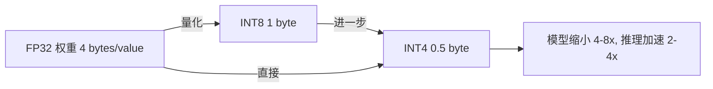

## 一句话理解

模型量化（Quantization）是将神经网络中原本用 32-bit 浮点数（FP32）表示的权重和激活值，转换为更低精度（如 FP16、INT8、INT4）的数值表示，从而大幅减少模型体积、降低显存占用、加速推理速度，同时尽力保持模型精度不显著下降。

## 零基础理解

想象你有一张 5000 万像素的 RAW 格式照片（FP32 模型），文件大小 50MB。你可以看清照片中每个人脸上的毛孔，但发给朋友时，微信会把它压缩成 500KB 的 JPEG（INT8 量化模型）。

- 压缩后的照片虽然丢失了一些细节，但**你仍然能认出照片里的人是谁**。
- 传输更快（推理加速），占用空间更小（显存节省）。
- 但如果你把照片压到极致（比如 10KB），那可能连人脸都看不清了（过度量化导致精度崩溃）。

量化做的就是这件事：**在"还能认出是谁"的前提下，把文件压到最小**。关键是找到那个"刚好够用"的精度级别。

## 核心概念



### 1. 数值精度对比

| 精度 | 位数 | 表示范围（大致） | 典型用途 | 说明 |
|------|------|-----------------|----------|------|
| FP32 | 32-bit | $\pm 3.4 \times 10^{38}$ | 训练和推理（原始精度） | 标准的单精度浮点，所有模型默认格式 |
| FP16 | 16-bit | $\pm 65504$ | 推理加速，混合精度训练 | 范围足够，精度损失极小，GPU 有原生加速单元 |
| BF16 | 16-bit | $\pm 3.4 \times 10^{38}$ | 训练（Google TPU, NVIDIA H100） | 范围与 FP32 相同但精度低，训练稳定性好于 FP16 |
| INT8 | 8-bit | $[-128, 127]$ | 推理加速（CPU/GPU） | 4x 压缩，精度损失可控，工业界成熟方案 |
| INT4 | 4-bit | $[-8, 7]$ | 极致推理压缩 | 8x 压缩，需要更精细的量化策略 |
| NF4 | 4-bit | 非均匀分布 | QLoRA 微调 | 基于正态分布的非均匀量化，对 LLM 权重分布更友好 |

### 2. 量化方式分类

#### 对称量化 vs 非对称量化

| 维度 | 对称量化 (Symmetric) | 非对称量化 (Asymmetric) |
|------|---------------------|------------------------|
| 零点 | 零点固定为 0 | 零点可以是任意值 |
| 公式 | $q = \text{round}(r / s)$ | $q = \text{round}(r / s) + z$ |
| 优点 | 计算简单，硬件实现友好 | 更好利用量化范围，尤其适合 ReLU 后的激活值 |
| 缺点 | 如果数据分布不对称会浪费量化范围 | 推理时需要额外的零点减法 |
| 典型场景 | 权重量化（权重通常对称分布在 0 附近） | 激活值量化（ReLU 后全为非负） |

#### 量化粒度对比

| 粒度 | 描述 | 优点 | 缺点 | 精度 |
|------|------|------|------|------|
| 逐张量 (Per-tensor) | 整个张量共享一个 scale 和 zero-point | 计算最快，内存开销最小 | 精度损失最大 | 最低 |
| 逐通道 (Per-channel) | 每个通道独立使用 scale 和 zero-point | 精度显著优于逐张量 | 计算稍复杂，硬件支持需适配 | 中等 |
| 逐组 (Per-group) | 将通道分成若干组，每组独立量化 | 精度最高，灵活性好 | 需要存储多组 scale/zero-point | 最高 |

> 实践中，per-channel 权重量化 + per-tensor 激活量化的组合是 INT8 推理的最常见配置。

### 3. 量化时机

- **训练后量化（Post-Training Quantization, PTQ）**：不重新训练，直接在训练好的模型上做量化。速度快，但精度可能下降较多，尤其是在 INT4 及以下精度。
- **量化感知训练（Quantization-Aware Training, QAT）**：在训练过程中模拟量化误差，让模型学会适应量化。精度更高，但需要重新训练，成本大。

## 2026 年主流量化方案对比

| 方案 | 精度 | 核心思想 | 推理引擎 | 显存节省（相对 FP16） | 速度提升 | 主要优势 | 主要劣势 | 推荐场景 |
|------|------|----------|----------|---------------------|----------|----------|----------|----------|
| GGUF | INT4/INT8 | 逐组量化，CPU 优先 | llama.cpp, Ollama, LM Studio | ~4x (INT4) | 中等（CPU 推理） | CPU 友好，无需 GPU，生态成熟 | GPU 推理效率不如专用方案 | 本地 CPU 部署，消费级设备 |
| AWQ | INT4 | 基于激活感知的权重重要性保护显著权重 | vLLM, TGI, TensorRT-LLM | ~4x | **高**（GPU 推理） | 精度保持优秀，2026 年事实标准 | 仅支持 Ampere 及以上 GPU (SM80+) | 2026 年默认推荐，GPU 推理首选 |
| GPTQ | INT4 | 基于 Optimal Brain Surgeon 的逐层量化 | vLLM, TGI, ExLlama | ~4x | 高 | 经典方案，社区支持好 | 量化过程需要校准数据，速度略慢于 AWQ | 需要与旧版生态兼容的场景 |
| bitsandbytes | INT4/INT8/NF4 | HuggingFace 原生集成，QLoRA 的基础 | HuggingFace Transformers | ~4x (NF4) | 中等 | 与 HuggingFace 无缝集成，QLoRA 生态 | 推理速度不如 AWQ/GPTQ 专用方案 | 快速实验，QLoRA 微调 |
| FP8 | 8-bit | H100/B200/RTX 50 系列原生支持 | TensorRT-LLM, vLLM | ~2x | 高（硬件加速） | 硬件原生支持，精度损失极小 | 需要最新 GPU，生态仍在建设中 | 有 H100/B200 时的首选 |

### 方案选择决策树

```
需要本地 CPU 部署？
  ├── 是 → GGUF + llama.cpp / Ollama
  └── 否 → 有 GPU（显存 >= 8GB）？
            ├── 否 → GGUF（CPU 推理）
            └── 是 → GPU 架构？
                      ├── H100/B200/RTX 50xx → FP8（最新硬件，原生支持）
                      ├── Ampere 及以上 (A100/A6000/RTX 30xx/40xx) → AWQ INT4
                      └── 更老的 GPU → GPTQ 或 bitsandbytes
```

## 量化对模型质量的影响

### 困惑度退化（PPL Degradation）

困惑度（Perplexity, PPL）是衡量语言模型质量的核心指标。以下是在 LLaMA 系列模型上不同量化精度的典型 PPL 变化：

| 量化方案 | 精度 | PPL 增量（相对 FP16） | 主观质量 | 判断 |
|----------|------|----------------------|----------|------|
| FP16 | 16-bit | 0（基准） | 完美 | 无损基准 |
| INT8 | 8-bit | +0.01 ~ +0.05 | 几乎无差别 | 可以放心使用 |
| INT4 (AWQ) | 4-bit | +0.1 ~ +0.3 | 绝大多数任务无感知差异 | 推荐使用 |
| INT4 (GPTQ) | 4-bit | +0.1 ~ +0.5 | 部分复杂推理任务有轻微退化 | 可用，但 AWQ 更优 |
| INT4 (GGUF) | 4-bit | +0.2 ~ +0.6 | 少量退化，推理结果可接受 | 本地部署可用 |
| INT3 | 3-bit | +0.5 ~ +2.0 | 明显退化 | 不建议，除非极端资源受限 |
| INT2 | 2-bit | +5.0 ~ +15.0 | 严重退化，基本不可用 | 仅用于研究 |

### 什么时候可以量化 / 什么时候不该量化

**可以放心量化的情况：**
- 模型参数量大（>= 7B）：大模型对量化的容忍度更高，因为冗余参数多。
- 简单任务：文本摘要、翻译、对话、分类等对精度不敏感的任务。
- 有足够校准数据：用领域内数据做校准可以显著提升量化后精度。
- INT8 量化：几乎总是安全的，精度损失可以忽略不计。

**不该量化或需谨慎的情况：**
- 小模型（< 3B）：参数少，量化冗余少，精度损失更明显。
- 复杂推理任务：数学推理、代码生成、多步逻辑推理对精度敏感。
- 低资源语言：模型对该语言的表示能力本身就不够，量化会进一步削弱。
- 需要精确概率的场景：如校准后的置信度判断。
- 极端量化（INT3 及以下）：除非有 QAT 或特殊量化策略，否则不建议。

## 2026 年推荐汇总

| 场景 | 推荐方案 | 工具链 |
|------|----------|--------|
| 开发实验、快速试模型 | bitsandbytes NF4 | HuggingFace `load_in_4bit=True` |
| GPU 生产推理 | **AWQ INT4** | vLLM / TGI / TensorRT-LLM |
| 本地 CPU 部署 | GGUF (Q4_K_M) | Ollama / llama.cpp |
| 最新 NVIDIA GPU (H100/B200) | FP8 | TensorRT-LLM / vLLM |
| QLoRA 微调 | bitsandbytes NF4 | HuggingFace PEFT + bitsandbytes |
| 边缘设备 / 手机 | INT8 / INT4 (QAT) | TensorFlow Lite / MLC-LLM |

> 2026 年核心建议：如果不确定，**AWQ INT4 是 GPU 推理的默认安全选择**，**GGUF Q4_K_M 是本地 CPU 部署的默认安全选择**。INT8 几乎总是安全的，可以放心使用。

## 相关笔记

- [[Ch20 模型推理部署]] —— 模型部署的完整流程，包括量化、剪枝、蒸馏等压缩技术
- [[深挖-LoRA微调]] —— PEFT 微调方法，与量化结合可大幅降低微调显存
- [[深挖-QLoRA]] —— NF4 量化 + LoRA，单卡微调大模型的核心技术（Dettmers 2023）
- [[概念-vLLM]] —— 高性能 LLM 推理引擎，原生支持 AWQ/GPTQ 量化模型
- [[概念-llama.cpp]] —— CPU 推理框架，GGUF 格式的运行环境
- [[概念-Ollama]] —— 基于 llama.cpp 的一键部署工具，封装了 GGUF 量化模型
- [[概念-模型压缩]] —— 量化、剪枝、蒸馏、低秩分解四类压缩方案的对比

## 来源

- Dettmers, T., et al. (2023). QLoRA: Efficient Finetuning of Quantized LLMs. *NeurIPS 2023*. https://arxiv.org/abs/2305.14314
- Lin, J., et al. (2023). AWQ: Activation-aware Weight Quantization for LLM Compression and Acceleration. https://arxiv.org/abs/2306.00978
- Frantar, E., et al. (2022). GPTQ: Accurate Post-Training Quantization for Generative Pre-trained Transformers. *ICLR 2023*. https://arxiv.org/abs/2210.17323
- llama.cpp GitHub: https://github.com/ggml-org/llama.cpp
- HuggingFace Quantization 文档: https://huggingface.co/docs/transformers/quantization
- Nagel, M., et al. (2021). A White Paper on Neural Network Quantization. https://arxiv.org/abs/2106.08295
- NVIDIA TensorRT-LLM Quantization: https://github.com/NVIDIA/TensorRT-LLM
- Gholami, A., et al. (2022). A Survey of Quantization Methods for Efficient Neural Network Inference. https://arxiv.org/abs/2103.13630