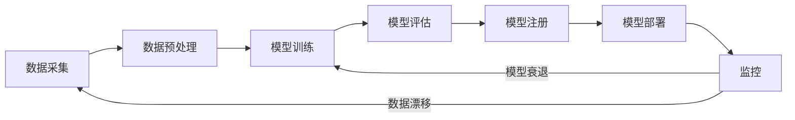

你训练好了一个模型（[[Ch11 模型微调]]），怎么让它上线给别人用？怎么知道它在生产环境跑得好不好？怎么把模型更新从"手动折腾半天"变成"代码推送自动完成"？MLOps（机器学习运维）就是管这些事的。

MLOps 本质上是一套**从实验到生产的工程化方法**。它解决的核心问题是：数据科学家在 Jupyter Notebook 里跑出来一个好模型，和这个模型在生产环境稳定运行之间，隔着巨大的鸿沟——模型需要变成 API，需要能复现实验，需要自动更新，需要在线上被人盯着。本章从部署、管理、监控三个角度搭建 MLOps 的基础认知。

> **生活比喻**：MLOps 像开餐厅——模型训练是研发新菜（厨房实验），部署是正式营业（上线服务），监控是看顾客反馈：菜变味了没（数据漂移）、顾客口味变了没（概念漂移）。CI/CD 是标准化流程——从研发到上菜，每一步都有章可循，不会每次手忙脚乱。没有这套流程，你的"招牌菜"可能只在厨房里好吃，端上桌就变味了。

## 本章目录

1. [[21.1 模型怎么变成服务|21.1 模型怎么变成服务]] — FastAPI + Docker + 云部署选项
2. [[21.2 MLOps成熟度模型|21.2 MLOps成熟度模型]] — Level 0-3：从手动到全自动
3. [[21.3 实验管理|21.3 实验管理]] — MLflow 实验追踪 + 模型版本管理
4. [[21.4 小型团队MLOps最低可行方案|21.4 小型团队MLOps最低可行方案]] — 3-5人团队的实用工具清单
5. [[21.6 生产监控|21.6 生产监控]] — 数据漂移、概念漂移、监控工具
6. [[21.7 CICD|21.7 CI/CD]] — 从代码提交到自动部署的流水线
7. [[21.9 2026年MLOps趋势|21.9 2026年MLOps趋势]] — LLMOps、AgentOps、评估自动化

## 相关笔记

- [[Ch20 模型推理部署]] — 模型怎么跑起来
- [[Ch11 模型微调]] — 训练是 MLOps 的上游
- [[概念-LLM可观测性]] — LLM 生产环境监控的深度方案
- [[概念-Guardrails]] — 生产环境安全防护框架
- [[概念-RedTeaming]] — 部署前的安全红队测试

## 跨章节关联

- [[Ch20 模型推理部署]] — 部署之后：运维和监控
- [[Ch11 模型微调]] — 微调的工程化：实验管理、版本控制
- [[Ch14 Agent 工作原理]] — Agent 的生产监控
- [[Ch22 AI 技术全景]] — MLOps 在技术全景中的位置

## 来源

- MLflow, https://mlflow.org
- FastAPI, https://fastapi.tiangolo.com
- Docker, https://docs.docker.com
- Evidently AI, https://www.evidentlyai.com
