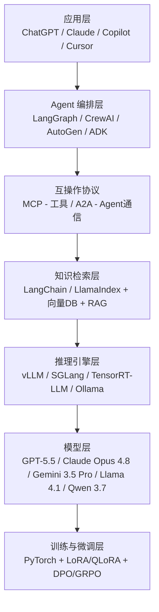

## 概念

AI 应用不是"一个模型"，而是一组技术像楼房的楼层一样叠在一起的**技术栈**（tech stack）。就像你点外卖：你打开手机 App（应用层），App 把你的订单发给商家管理后台（编排层），后台通过统一的接口协议对接骑手（互操作层），骑手从最近的仓库取餐（检索层），仓库用保温箱保持餐品质量（推理引擎层），餐品本身是厨房做出来的（模型层），而厨师的手艺来自长期训练（训练层）。每一层出了问题，外卖就送不到你手上。

2026 年的标准 AI 全栈包含七层，从用户触达一直通到模型训练：^[O'Reilly Radar, "The AI Agents Stack 2026 Edition", https://www.oreilly.com/radar/the-ai-agents-stack-2026-edition/]

## 教学：逐层拆解

**应用层**是你直接接触的界面 -- ChatGPT 的对话窗口、Cursor 的代码编辑器、Copilot 的补全弹窗。这层的任务是让用户用自然语言表达需求，而不需要理解底下任何一层是怎么工作的。

**Agent 编排层**是"大脑的手"。模型输出一个意图，编排层把它翻译成一系列动作：先去查数据库，再调计算器，最后把结果汇总。就像秘书接到老板的指令后自己去查文件、打电话、发邮件，然后把结论交回来。主流框架各有侧重：LangGraph 擅长精细控制多步流程，CrewAI 专注于让多个"角色 Agent"协作，AutoGen 深度集成微软 Azure 生态，Google ADK 则为 Gemini 和 GCP 用户量身定制。^[MachineLearningMastery.com, "The AI Agent Tech Stack Explained", https://machinelearningmastery.com/the-ai-agent-tech-stack-explained/]

**互操作协议层**是 2026 年最重要的基础设施创新。它解决了一个关键问题：不同厂商的 AI 工具怎么互相配合？MCP（Model Context Protocol，Anthropic 提出）统一了 AI 调用外部工具的接口标准，就像所有电子设备共用 USB-C 充电口。A2A（Agent-to-Agent，Google 提出）则让不同框架的 Agent 互相对话，就像不同国家的外交官使用同一种外交语言。两者互补：MCP 管工具，A2A 管协作。^[Anthropic, "Introducing MCP", https://www.anthropic.com/news/model-context-protocol]; ^[Google Developers Blog, "Announcing A2A", https://developers.googleblog.com]

**知识检索层**实现了"给 AI 外挂一个图书馆"。模型自身的知识截止于训练日期，而 RAG（Retrieval-Augmented Generation，检索增强生成）让模型在回答前先去查阅外部文档库。核心流程是：文档加载 -> 文本分块 -> 嵌入向量化 -> 存入向量库 -> 用户查询时检索 -> 重排序 -> 把最相关的片段喂给模型生成答案。2026 年混合检索（稠密向量 + BM25 关键词）已成标配，Graph RAG（知识图谱增强检索）和 Agentic RAG（Agent 自主决定检索策略）正在崛起。^[Firecrawl, "RAG Guide", https://firecrawl.dev]; ^[FutureAGI, "RAG Architecture 2026", https://futureagi.com/blog/rag-architecture-llm-2025/]

**推理引擎层**是"让模型跑得又快又省"的加速器。一个 70B 参数的模型如果用原始方式运行，普通显卡根本带不动。推理引擎通过 PagedAttention（把注意力计算的缓存像操作系统分页一样管理）、连续批处理（把多个请求合并一起算）和量化（把 16-bit 浮点数压缩到 4-bit，精度损失极小但内存占用减半）等技术，让大模型能在普通硬件上流畅运行。vLLM 是云端生产环境的首选，SGLang 在对延迟敏感的在线服务中表现突出，TensorRT-LLM 是 NVIDIA 显卡的极致优化方案，Ollama 和 llama.cpp 则让消费级硬件也能跑大模型。^[RedHat, "LLM Inference Guide", https://developers.redhat.com/articles/2024/11/07/how-optimize-ai-inference]; ^[DeployBase, "LLM Inference Engines Compared", https://deploybase.ai]

**模型层**是 AI 的"发动机"本身。2026 年市场呈现双轨格局：闭源旗舰（GPT-5.5、Claude Opus 4.8、Gemini 3.5 Pro）在复杂推理和多模态任务上领先；开源模型（Llama 4.1、Qwen 3.7、DeepSeek-V3）在成本和可控性上优势明显，许多企业场景中开源模型已足够好用。选择模型的核心考量不是"哪个最强"，而是"哪个最适合我的任务、预算和延迟要求"。^[Kellton, "AI Tech Stack 2026", https://kellton.com/kellton-tech-blog/ai-tech-stack-2026]

**训练与微调层**是 AI 的"学校"。基座模型通过在海量互联网文本上预训练获得通用能力，然后在专门数据上微调以适应特定场景。2026 年标准管线是"三阶段"：SFT（监督微调，教模型回答格式）-> LoRA/QLoRA（高效适配，只训练极少参数）-> DPO/GRPO（偏好对齐，让模型输出更符合人类偏好）。其中 GRPO（分组相对策略优化）被 DeepSeek-R1 采用后成为推理类任务的标配方法。^[FutureAGI, "LLM Fine-Tuning Guide 2026", https://futureagi.com/blog/llm-fine-tuning-guide-2025/]; ^[llm-stats.com, "Post-Training in 2026: GRPO, DAPO, RLVR & Beyond", https://llm-stats.com/blog/research/post-training-techniques-2026]

## 注意事项

**不要追求每一层都用"最好的"。** AI 技术栈的核心原则是"适合的比最强的更重要"。一个只有 100 个用户的小工具不需要 vLLM 集群 -- Ollama 单机部署就够用。反之，一个千万用户的产品只用 Ollama 则会在高峰期崩溃。从需求量最小的层开始选型，逐步向上堆叠。

**不要跳过互操作层。** 2025 年之前，很多团队把 Agent 直接和具体工具硬编码绑定，结果是换一个模型或换一个工具就要重写大量代码。MCP 和 A2A 协议的价值不在于它们本身多强大，而在于它们让你可以随时替换底下的任何一层 -- 模型换了、向量库换了、工具换了，上层的 Agent 逻辑不受影响。

**全栈不等于全都要自己建。** 2026 年的趋势是分层外包：应用层用 ChatGPT/Claude 的现成界面，编排层用 LangGraph 或 CrewAI，推理层用云服务商提供的托管 API，只有当你需要极致的成本控制或数据隐私时才自己从底层搭建。^[Blockchain.News, "AI Engineering Stack 2026 Guide Outlines 10 Layers", https://blockchain.news/ainews/ai-engineering-stack-2026-guide-outlines-10-layers]

## 关联

本章余下各节按栈从下往上展开：[[22.2 推理引擎-从云端到边缘|22.2 推理引擎]] 覆盖推理引擎层，[[22.3 Agent 框架-选型指南|22.3 Agent 框架]] 覆盖编排层和互操作层，[[22.4 微调技术-SFT → LoRA → DPO 管线|22.4 微调技术]] 覆盖训练层，[[22.5 RAG 技术栈|22.5 RAG 技术栈]] 覆盖检索层，[[22.6 多模态模型一览|22.6 多模态模型]] 覆盖模型层中除文本外的视觉、语音和视频能力。

更深入的专题：
- 推理引擎实操见 [[../Ch20 推理部署/Ch20 模型推理部署|第20章：AI 推理部署]]
- Agent 框架详解见 [[Ch16 多 Agent 协作|第16章：多 Agent 协作]]
- RAG 体系见 [[../Ch13 RAG/Ch13 RAG 进化树|第13章：RAG 检索增强]]
- 向量数据库见 [[../Ch13 RAG/Ch13 RAG 进化树|第13章相关小节]]

子文件夹：
- [[概念/概念-AI编程工具|概念：AI 编程工具]]
- [[概念/概念-ObsidianGraphView|概念：Obsidian 图谱视图]]
- [[项目/摘要|项目摘要]]

---

> ← 上一节：[[Ch22 AI 技术全景|章首]] ｜ 下一节：[[22.2 推理引擎-从云端到边缘]] →
