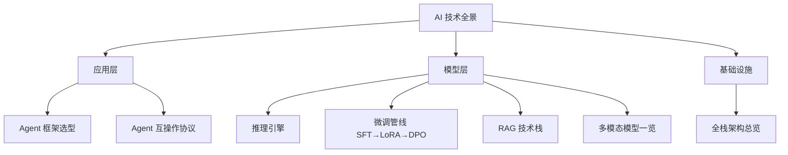

> 本章给出一张全栈地图。知道"有什么"比知道"怎么用"更优先 -- 当你知道 vLLM 存在，自然会去查怎么部署；如果不知道，你可能以为只有 Ollama 一条路。
>
> 从应用层到训练层，七层架构逐层展开：全栈总览（22.1）-> 推理引擎（22.2）-> Agent 框架与互操作协议（22.3）-> 微调管线 SFT -> LoRA -> DPO（22.4）-> RAG 技术栈（22.5）-> 多模态模型（22.6）。每节包含概念讲解、教学方法、注意事项和关联指引，零基础读者可顺序阅读。
>
> **本章阅读指引**：作为汇总章，大量工具和框架名密集出现。已在前面章节详细讲过的术语标注了"详见第X章"；全新的工具给出简短的一句话解释 -- 知道它是干什么的即可，不需要在此展开。

> **生活比喻**：AI 技术栈像一座城市的地图——应用层是街边的商店（用户直接用的产品），模型层是工厂（生产智能的地方），基础设施是水管电网（算力、存储、网络）。你不需要记住每条街的名字，但有了这张地图，你就知道去哪找什么，不会迷路。

## 本章目录

1. [[22.1 全栈架构|22.1 全栈架构]]
2. [[22.2 推理引擎-从云端到边缘|22.2 推理引擎：从云端到边缘]]
3. [[22.3 Agent 框架-选型指南|22.3 Agent 框架：选型指南]]
4. [[22.4 微调技术-SFT → LoRA → DPO 管线|22.4 微调技术：SFT -> LoRA -> DPO 管线]]
5. [[22.5 RAG 技术栈|22.5 RAG 技术栈]]
6. [[22.6 多模态模型一览|22.6 多模态模型一览]]

## 跨章节关联

- [[Ch11 模型微调]] — 微调技术栈全景
- [[Ch13 RAG 进化树]] — RAG 技术栈全景
- [[Ch14 Agent 工作原理]] — Agent 框架全景
- [[Ch20 模型推理部署]] — 推理引擎全景
- [[Ch21 MLOps 基础]] — MLOps 工具链全景

## 来源

1. O'Reilly Radar, "The AI Agents Stack 2026 Edition", https://www.oreilly.com/radar/the-ai-agents-stack-2026-edition/
2. Kellton, "AI Tech Stack 2026", https://kellton.com/kellton-tech-blog/ai-tech-stack-2026
3. RedHat, "LLM Inference Guide", https://developers.redhat.com/articles/2024/11/07/how-optimize-ai-inference
4. DeployBase, "LLM Inference Engines Compared", https://deploybase.ai
5. JarvisLabs, "Best LLM Inference Engines 2025", https://jarvislabs.ai/blogs/llm-inference
6. TensorFoundry, "LLM Quantization Guide", https://tensorfoundry.io
7. Read The AI Merge, "Quantization Landscape 2025", https://read.theaimerge.com
8. LangChain Resources, https://langchain.com/resources
9. Alice Labs, "Agent Framework Comparison", https://alicelabs.ai
10. GuruSup, "AI Agent Frameworks 2026", https://gurusup.com
11. Anthropic, "Introducing MCP", https://www.anthropic.com/news/model-context-protocol
12. Google Developers Blog, "Announcing A2A", https://developers.googleblog.com
13. OpenAgents, https://openagents.org
14. Zylos, "MCP+A2A Guide", https://zylos.ai
15. FutureAGI, "LLM Fine-Tuning Guide 2026", https://futureagi.com/blog/llm-fine-tuning-guide-2025/
16. llm-stats.com, "Post-Training in 2026: GRPO, DAPO, RLVR & Beyond", https://llm-stats.com/blog/research/post-training-techniques-2026
17. Sundeep Teki, "SFT, RLHF, DPO, GRPO Guide", https://www.sundeepteki.org/advice/the-complete-guide-to-post-training-llms-how-sft-rlhf-dpo-and-grpo-shape-llms
18. Spheron, "DPO Fine-tuning", https://www.spheron.network/blog/dpo-fine-tuning-gpu-cloud/
19. Kensink, "Fine-tuning Methods", https://www.kensink.com/llm/fine-tuning/methods/
20. HuggingFace TRL, https://github.com/huggingface/trl
21. Unsloth, https://github.com/unslothai/unsloth
22. Axolotl, https://github.com/OpenAccess-AI-Collective/axolotl
23. Firecrawl, "RAG Guide", https://firecrawl.dev
24. FutureAGI, "RAG Architecture 2026", https://futureagi.com/blog/rag-architecture-llm-2025/
25. Medium Data Science Collective, "RAG Stack 2026"
26. LinkedIn, "2026 RAG Stack Evolution"
27. StackAI, "RAG Best Practices", https://stackai.com
28. Atlan, "12 Advanced RAG Techniques Beyond Naive Retrieval 2026", https://atlan.com/know/advanced-rag-techniques/
29. Atolio, "Enterprise RAG in 2026: Challenges, Architecture, and Best Practices", https://www.atolio.com/blog/enterprise-rag-guide
30. MachineLearningMastery.com, "The AI Agent Tech Stack Explained", https://machinelearningmastery.com/the-ai-agent-tech-stack-explained/
31. Blockchain.News, "AI Engineering Stack 2026 Guide Outlines 10 Layers", https://blockchain.news/ainews/ai-engineering-stack-2026-guide-outlines-10-layers
32. Blockchain.News, "AI Master Stack 2026 Breakdown", https://blockchain.news/ainews/ai-master-stack-2026-breakdown-and-business-guide
33. GOpenAI Blog, "Multimodal AI Landscape"
34. MDPI, "Vision-Language Models Survey"
35. Chunming He, "Awesome Multimodal", https://github.com/ChunmingHe

