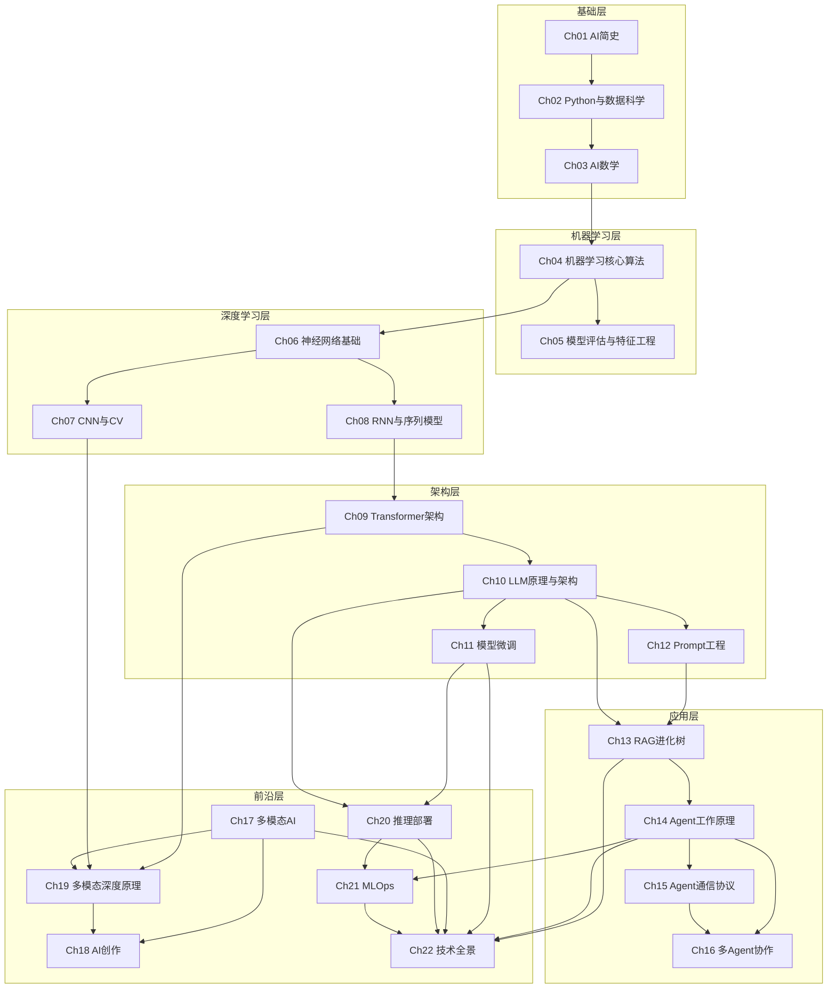

> 22 章之间的关联关系。每一条线代表一个跨章节的知识依赖。

## 层间依赖说明

| 层 | 依赖 | 核心问题 |
|------|------|------|
| 深度学习层 | 机器学习层 | 从"手工特征"到"自动学习特征" |
| 架构层 | 深度学习层 | 从"CNN/RNN"到"Transformer 统一架构" |
| 应用层 | 架构层 | 从"模型本身"到"怎么用模型" |
| 前沿层 | 应用层 | 从"单模态/单Agent"到"多模态/多Agent/生产部署" |

## 关键交叉节点

| 节点 | 被引用 | 引出 |
|------|--------|------|
| Ch09 Transformer | Ch08 | Ch10, Ch19 |
| Ch10 LLM | Ch09 | Ch11, Ch12, Ch13, Ch20 |
| Ch13 RAG | Ch10, Ch12 | Ch14 |
| Ch14 Agent | Ch13 | Ch15, Ch16, Ch21 |
| Ch20 推理部署 | Ch10, Ch11 | Ch21 |

## 相关笔记

- [[知识图谱]] — 四条演化轴
- [[标签索引]] — 按标签浏览
- [[从哪里开始]] — 学习路径